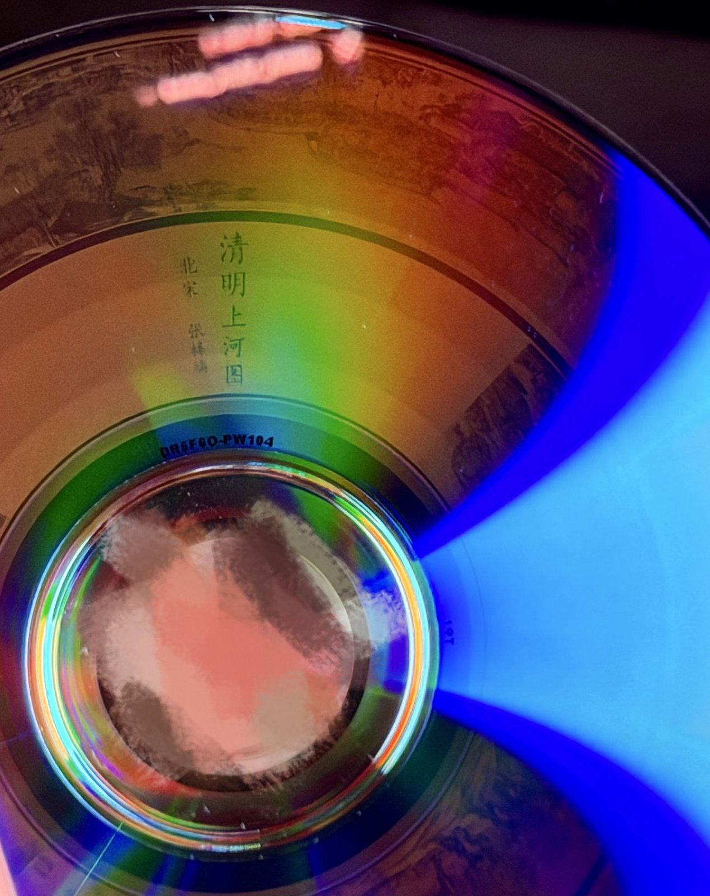
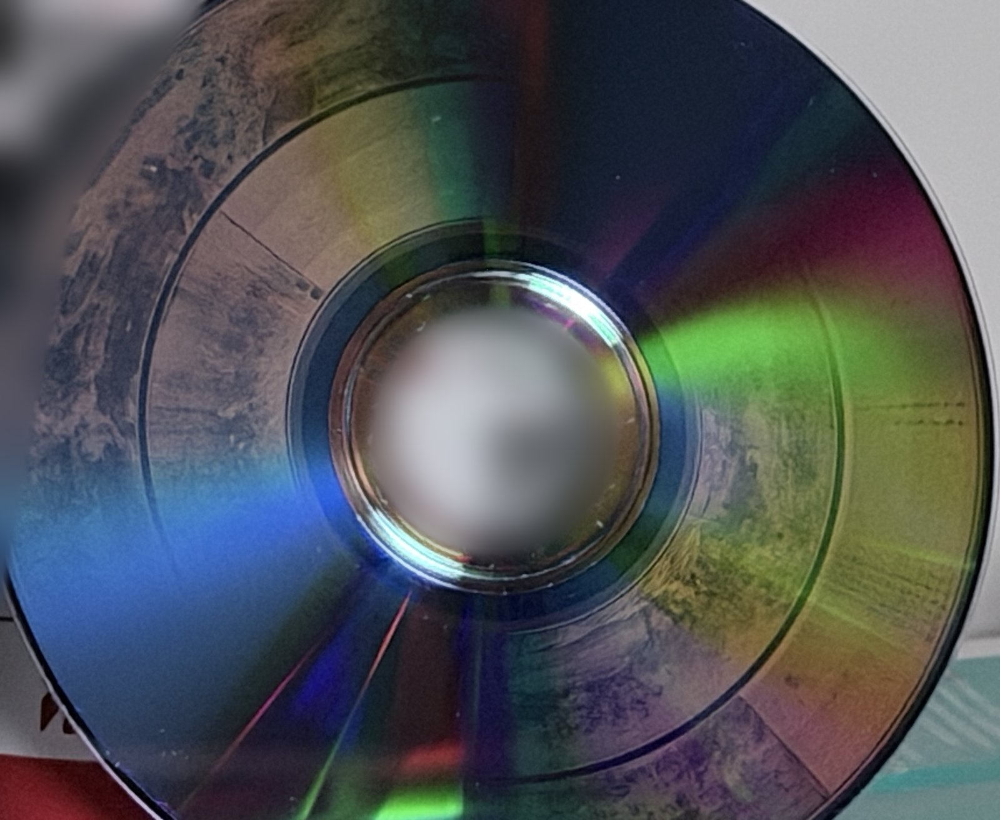
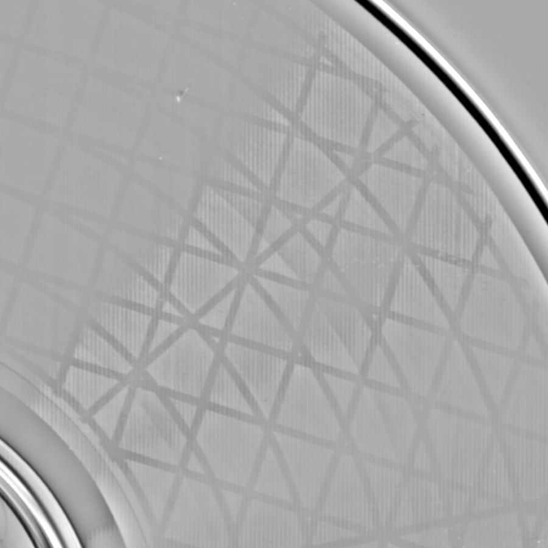
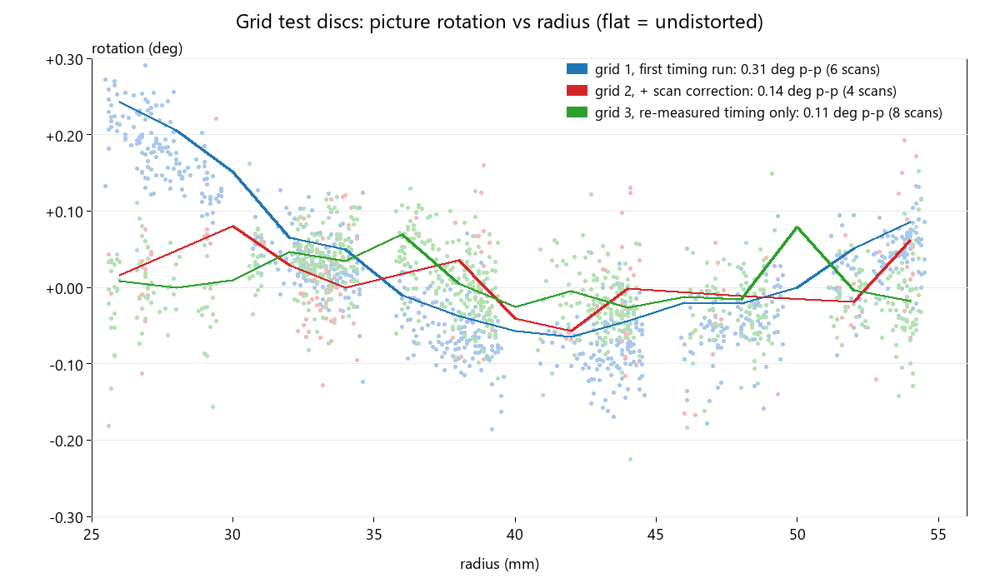
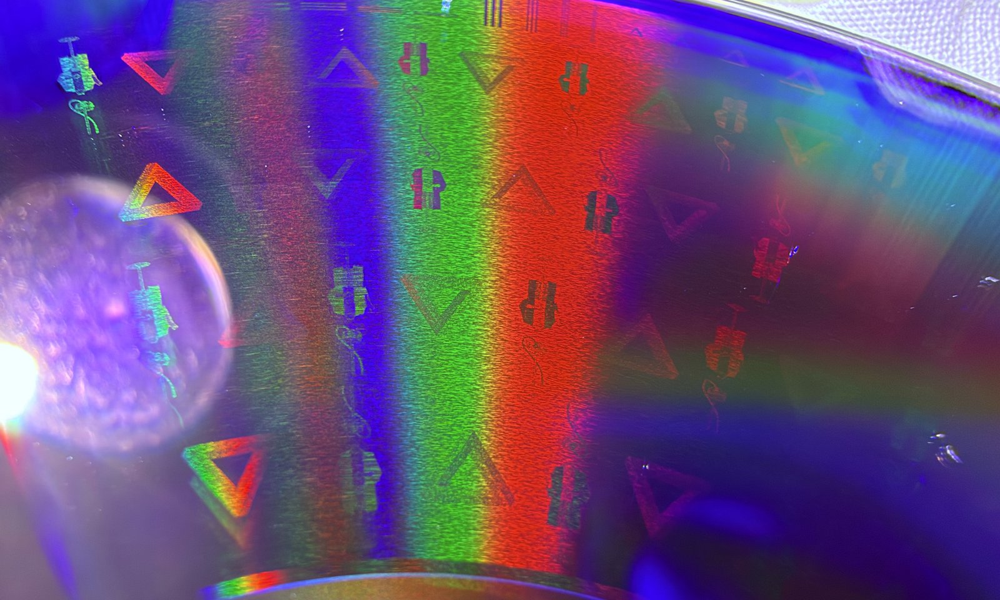
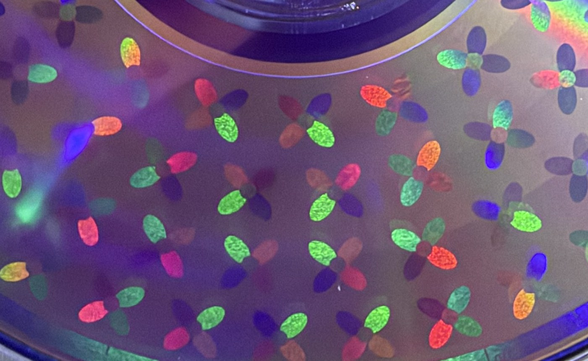

# disc-probe

English | [简体中文](README.md)

disc-probe uses an ordinary optical drive to measure the spiral geometry of a disc, then burns pictures onto the data side of DVD-R or CD-R. You don't need to take photos or mark points by hand.

<p>


</p>

*Along the River During the Qingming Festival* on a Ritek F1 DVD-R, straight from the burner. The geometry came entirely from read timing, and the disc was burned once, with no test burn, photo calibration or scan correction. These are phone photos, cropped to the disc and downsized, with the background blurred.

## How it works

To burn a picture on the data side, you need to know the angle at which sector N lands on the disc. Track pitch and bit length differ very slightly from batch to batch. Over tens of thousands of turns that adds up, and the picture twists into a whirlpool. The usual fix is to burn a calibration pattern, photograph it, mark points and correct over several rounds.

disc-probe has the drive measure this instead. On a disc spinning at constant speed, a sector finishes reading at the moment it passes under the head. Read two sectors in turn, convert the difference in completion time to an angle, and you know how far apart they are on the disc. Each reading only gives the angle modulo 360°, so the tool works outward in steps, using the earlier steps to predict the number of whole turns. About 20 steps cover the disc.

The measurement only sends read commands. Its result can go straight into a burnable ISO or be exported as a [DiscImageStudio](https://github.com/JiaFeiMiao-K-Cat/DiscImageStudio) preset.

## Results

### Geometric accuracy



This is part of a test grid disc, from a 600 dpi flatbed scan with a high-pass filter, about 38 mm across. This disc also used timing alone and was burned once (HL-DT-ST GH70N, Ritek F1 DVD-R). Eight scans put the rotation error over 25 to 54 mm at 0.11° peak to peak and 0.03° rms. At a 50 mm radius, 0.03° is about 0.03 mm.



The green line in this plot is that disc. The measurement plan was [registered before the burn](docs/PREREG_remeasure.md) (in Chinese).

### Fine detail



A macro photo of the dense tiling disc, also burned once. The impossible triangles are 4.2 mm wide and the small figures are 6.8 mm tall. Along the top are groups of three lines for testing line width. The smallest triangle, 1 mm wide with edges of about 0.15 mm, is clearly visible to the naked eye. A 600 dpi scan separates 0.12 mm lines and barely resolves 0.08 mm, which is the scanner's limit.

### Colour (experimental)



The petals use several periodic textures. The colours come from diffraction along the track and change with the viewing angle. This work is ongoing, in [Discussion #108](https://github.com/JiaFeiMiao-K-Cat/DiscImageStudio/discussions/108).

### Other drives and discs

- On RITEKF1 discs, our timing result is within about ±0.05° of bczhc's independent photo calibration ([DiscImageStudio #53](https://github.com/JiaFeiMiao-K-Cat/DiscImageStudio/issues/53)).
- A laptop drive about 15 years old (PLDS DS8A8SH, through a SATA-to-USB adapter) measured a geometry about 0.05° rms from our GH70N.
- CMC CD-R takes an extra step, because timing can't tell where the data sits along the track in absolute terms. A burned grid disc sets this constant. On the GH70N it is about 206 frames, and a second disc checked it to within +0.6 frames. The pitch on this batch also has a wave, which left 0.16° rms on the second disc.

## Quick start

You need Windows, Python 3.10 or later, a drive that can burn, and a few blank discs from the same batch. For Linux and macOS, see the ports listed under the [table of reports](#drives-with-hands-on-reports). The steps below are for DVD. The CD steps are in the [manual](docs/MANUAL.md#cd-r纹理计时与刻图), which is in Chinese for now.

Open a terminal as **administrator**, install the dependencies, and check your setup on the simulated drive:

```bash
git clone https://github.com/Ashley-QwQ/disc-probe
```

```bash
cd disc-probe
```

```bash
python -m pip install numpy pillow scipy
```

```bash
python -m discprobe selftest
```

**1. Burn a random-data disc.** The measuring disc must hold plain data, since discs with burned patterns often can't be read. Burn `iso/random.iso` with Windows Disc Image Burner.

```bash
python -m discprobe random --output iso/random.iso
```

**2. Check the drive.** This takes 1 to 3 minutes. You want to see `CAV` and as little jitter as possible.

```bash
python -m discprobe timing --drive H:
```

**3. Measure the geometry.**

```bash
python -m discprobe geo --drive H:
```

The pitch on some discs drifts slowly, and `geo` tells you when the residual is high. RITEKF1 is fine with a constant pitch, while `CMC MAG. AM3` and one RITEK DVD+RW needed a quadratic correction (residuals fell from 0.38° and 0.61° to about 0.08°). If you see that message, refit the results. You don't need to measure again, and it prints the residual for each model. If quadratic is clearly better, write a correction file:

```bash
python tools/geo_polyfit.py results/geo-H-... --write-correction correction.json --order quadratic
```

**4. Build a picture ISO and burn it to a blank disc from the same batch.** Replace the path with the `summary.json` from step 3, and add `--correction correction.json` if you have a correction file. The tool then samples sectors and compares them byte by byte with the design.

```bash
python -m discprobe image --geo results/geo-H-.../summary.json --picture my_picture.png --output iso/picture.iso
```

To keep working in DiscImageStudio, export a preset. Set `--sectors` to your disc's sector count and the radius range to what `geo` measured, and add `--correction correction.json` if you have one. It prints the conversion error against the measurement, so check that before burning:

```bash
python -m discprobe disexport --geo results/geo-H-.../summary.json --sectors 2298496 --r-min 25.8 --r-max 54.5 --output dis_preset.json
```

The rainbow "pizza slices" you see on a disc are diffraction from the factory groove. The whole image shows up near the mirror direction of a small, bright light, with the light right next to your eye or camera.

<a name="drive-compatibility"></a>

## Drives with hands-on reports

This lists drives someone has tested so far, and a drive that isn't listed may still work. Run `timing` to find out. Most of the data comes from `timing`. You can add yours in [DiscImageStudio discussion #107](https://github.com/JiaFeiMiao-K-Cat/DiscImageStudio/discussions/107).

| Drive | Interface / OS | Disc | Cache | Rotation | Per-read jitter | Notes | Source |
|---|---|---|---|---|---|---|---|
| HL-DT-ST GH70N (NYA2) | SATA / Windows | Ritek F1 DVD-R | `fua` | CAV, about 2830 rpm at 4x | 0.43 to 0.55° | Ladder and burning both verified (about 0.1° on the first burn). Changes speed at about 53 mm | this repo |
| HL-DT-ST GH70N (NYA2) | SATA / Windows | CMC CD-R | `fua` | CAV. Use `--speed 1411` (about 2080 rpm). `--speed 2822` (3226 rpm) completes about 0.2 ms late past 49.8 mm and can't be used | 0.5 to 0.76° | CD ladder works. On this path (IMAPI burn, READ(12)) the along-track constant is about 206 frames, checked on two grid discs (+0.6 frames left on the second). This batch has a pitch wave of about 0.45° peak to peak | this repo |
| MATSHITA BD-MLT UJ260AF (1.01) | USB 3.0 / macOS ([discprobe-macos](https://github.com/NaiveTomcat/discprobe-macos)) | RITEK RiDATA printable DVD-R (MID `RITEKF1`) | `fua` | CAV, 2364 rpm | 0.65 to 0.87° | `geo` and `disexport` work, parameters in [#87](https://github.com/JiaFeiMiao-K-Cat/DiscImageStudio/issues/87), and someone has burned a picture with them. 0.13° rms from our GH70N Ritek F1 result over 25 to 58 mm (within ±0.2° past 30 mm). FUA re-reads always take two turns. SET CD SPEED to 4x doesn't change speed. `--sectors 16` recommended | NaiveTomcat, #107 |
| HL-DT-ST GP65NB60 (PF00) | USB / Windows | Ritek ExcellentX DVD+RW (`RITEK/004/48`), random data | `fua` | CAV: 2355 rpm with no `--speed`, 1432 rpm with `--speed 3324`, 3596 rpm with `--speed 11080` | 0.23 to 0.29° at 1432 rpm (26 to 34 µs), 0.53 to 0.65° at 2355 rpm, 1.07 to 1.12° at 3596 rpm | Very low jitter in degrees, so `--speed 3324` is recommended. Phases at 1432 and 2355 rpm agree within 0.17°. At 3596 rpm they differ by up to +0.97° near 52 mm. A disc with a burned calibration pattern couldn't be read, so use random data. `geo` finished 22 steps (`--speed 3324`) with rms 0.61° and chi2/dof 10.8 at constant pitch, and 0.078° and 0.20 at quadratic pitch, so the pitch on this disc drifts slowly and needs a correction. Not yet checked with a burn | FanJZSS, #107 |
| HL-DT-ST GP90NB70 (1.00, IO-DATA external) | USB / Windows | VHR12JP53SV4 DVD-R (MID `CMC MAG. AM3`), random data | `fua` | CAV, 2355 rpm (`--speed 5540`) | 0.25 to 0.28° (18 to 20 µs) | Very low jitter. `geo` (22 steps) and `disexport` work. Constant pitch gives rms 0.38° and quadratic pitch 0.087°, so the pitch on this disc drifts slowly. The user's [follow-up](https://github.com/JiaFeiMiao-K-Cat/DiscImageStudio/discussions/107#discussioncomment-19410771) reports a clear picture from the constant-pitch preset, even at the drive's maximum 8x write speed (photo to come, no quantitative image-error measurement yet). FUA re-reads take three turns | li-yifei, #107 |
| ASUS BW-16D1H-U (E116) | USB / Windows, Linux | RITEK ARITA DVD-R, random data; BD-R | `fua` | DVD: CAV, 9204 rpm (requests for 2770 and 5540 don't slow it). BD-R: about 9705 rpm at inner and middle zones, about 1655 rpm at the outer zone, unstable on the first run, judged mixed | about 200 µs at every speed (DVD 10 to 14°, BD-R 2 to 15°) | `geo` finishes, but **don't burn with its result**. Against the geometry of the same batch as #53, it is off by about 9.5° peak to peak over 27 to 54 mm (+7.7° at 54 mm), which fits a completion-time jump of about 0.2 ms past 50 mm | bczhc, #107 |
| PLDS DVD-RW DS8A8SH | SATA-to-USB / Windows, Linux ([bczhc/disc-probe](https://github.com/bczhc/disc-probe)) | RITEK ARITA DVD-R, random data | `fua` | CAV, 2388 rpm | Windows 0.52 to 0.88° (36 to 61 µs), Linux 1.37 to 1.62° (96 to 113 µs) | Laptop drive about 15 years old. `geo` works on Windows (22 points, rms 0.21°), about 0.05° rms from our GH70N and 0.02 to 0.23° from bczhc's photo calibration (#53) at 5 points. `geo` also works on Linux, 0.33° rms from the GH70N (about −0.85° at 27 mm) | bczhc, #107 |
| ASUS SDRW-08U9M-U | USB / Windows | RITEK ARITA DVD-R, random data | `fua` | CAV, 2355 rpm | 0.79 to 1.08° (56 to 76 µs) | Its 5 phases differ from the same disc on the DS8A8SH by −0.23, +0.25, −0.67, −0.05 and −0.04°. `geo` not yet run | bczhc, #107 |
| HP BD-RE BU20N (LG OEM, 0403) | USB / Windows, with WindowsNoEditor's own probe | Lenovo Thinkplus CD-R 80 min | reads far away first, READ CD single sector | CAV, 1241 rpm (`0x0583`), 2482 rpm (`0x0B06`) | about 0.45° at 1241 rpm (about 60 µs), about 1.3 to 3.0° at 2482 rpm | Measured with a different tool using the same method. Found a seam of about +0.2 mm along the track near sector 65,600 | WindowsNoEditor, #107 |
| Sony Optiarc AD-7201S (1H9K) | Windows | Memorex CD-R (ATIP 97:15:17), random data | `fua` | CAV, 2168 rpm (`--speed 2822`) | 0.61 to 0.68° (47 to 53 µs) | `geo` finished 36 steps, rms 0.51° with constant pitch and 0.35° with quadratic. A few points are far off, cause unknown. Along-track constant not yet measured. The reporter says DVD-R works too, data not attached | pugod124, [disc-probe #2](https://github.com/Ashley-QwQ/disc-probe/issues/2) |
| HL-DT-ST SP80NB80 (RC00) | USB / Windows | DVD-R (MID `CMC MAG. AM3` as read on the HP) | `fua` (about 200 ms, 8 turns) | CAV, 2355 rpm | about 236 to 1714 µs (3 to 24°) | Too noisy so far, and `geo` stops at its second step. A lower speed is still to be tried | Sliicy, [disc-probe #1](https://github.com/Ashley-QwQ/disc-probe/issues/1) |
| HP HLDS GUD0N (SD03) | internal / Windows | DVD-R (MID `CMC MAG. AM3`) | `flush` (older tool version) | CAV, 3591 to 4402 rpm | about 108 to 165 µs | Older `geo` stopped at LBA 68848, probably a whole-turn miscount. Re-test with the latest version pending | Sliicy, [disc-probe #1](https://github.com/Ashley-QwQ/disc-probe/issues/1) |
| PLDS DVD±RW DU-8A5LH | Windows, with WindowsNoEditor's own probe | POSO CD-R 80 min (ATIP 97:27:18) | reads far away first, READ CD | CAV, 2032 rpm (`0x06E4`); not constant at `0x0583` | median per-step σ 0.47° | Ladder residual rms 0.73°. Against the BU20N on the same disc, the geometry matches apart from an along-track constant of about 25 frames | WindowsNoEditor, #107 |
| ASUS SDRW-08D2S-U | USB / Windows | Verbatim CD-R | misjudged as `plain` by the tool (cache hit 8 ms, FUA 39 ms) | unknown | unknown | The cache bug is fixed, re-test pending | moodyos, #107 |

bczhc ported the tool to Linux: [bczhc/disc-probe](https://github.com/bczhc/disc-probe) (see its `README-linux.md`). NaiveTomcat ported it to macOS: [NaiveTomcat/discprobe-macos](https://github.com/NaiveTomcat/discprobe-macos) (GPL-3.0-or-later). The release includes a signed, notarized universal helper, so you don't need to compile anything.

## Limitations

Drives vary a lot. A drive that isn't CAV, or has a lot of jitter (200 µs, for example), may give a geometry you can't use, so run `timing` first.

Fast reads near the outer edge can mislead. At 3226 rpm the GH70N finishes CD reads about 0.2 ms late past 49.8 mm, which looks like a change in geometry. The effect is gone at lower speed.

So far we have only burned pictures ourselves on the GH70N. Results for other drives come from timing comparisons and burns by a few users.

On CD, the along-track constant has to come from a grid disc, and 206 frames only applies to the GH70N with an IMAPI burn and READ(12) reads. CMC CD-R also drops about 0.4° near 33 mm, possibly a seam from burning, which we are still checking.

`geo` supports DVD and CD only. Blu-ray discs can only run `timing`.

## Safety

The drive code only sends read commands. A whitelist in [`discprobe/scsi.py`](discprobe/scsi.py) rejects any other opcode before it reaches the device, and the self-test confirms that WRITE, CLOSE TRACK and FORMAT UNIT are refused. The one command that changes drive state is `SET CD SPEED`, sent only if you pass `--speed` or `--cav`. Burning is left to Windows' own burning components, and [`tools/burn_imapi.ps1`](tools/burn_imapi.ps1) only writes when given `-Burn`.

## Documentation

The manual, notes and CD model are in Chinese for now.

| Document | Contents |
|---|---|
| [Manual](docs/MANUAL.md) | How each command works, its options, outputs and self-test results, including the spoke disc, texture ring disc, multi-hypothesis calibration disc and CD |
| [Notes](docs/KNOWLEDGE.md) | Method, hardware measurements, pitfalls and conclusions |
| [CD physical model](docs/CD_PHYSICAL_MODEL.md) | CD implementation and timing assumptions |
| [Showcase](docs/showcase/README.md) | Which disc each photo shows and how it was burned (in English) |
| [`evidence/`](evidence/README.md) | Raw measurements and figures, reproducible |

## Prior work and thanks

Measuring sector angles from read timing didn't start here:

- Data Position Measurement (DPM) in disc copy protection, used by SecuROM 4 and later.
- A 2025 discussion on the redump forum about timing a full turn by re-reading one sector with FUA.
- Philips patent US7538787B2 on writing labels on optical discs (priority 2002, lapsed 2017), which describes the same idea for burning visible labels in the data area: timestamps at the end of ECC blocks, repeated reads for the rotation period, and jump distances doubling each round.

This repository adds an open source implementation that can be reproduced on ordinary consumer drives and handles the problems real drives have. It uses covariance-driven stepwise measurement with uncertainty estimates, checks results on burned grid discs, carries corrections across discs, and exports DiscImageStudio presets.

The data-side encoding follows [DiscImageStudio](https://github.com/JiaFeiMiao-K-Cat/DiscImageStudio), and `discprobe/efmplus.py` is ported from it. Thanks to NaiveTomcat and bczhc for the ports, and to bczhc, NaiveTomcat, FanJZSS and moodyos for measurements.

## License

Copyright (C) 2026 Ashley-QwQ

This program is free software: you can redistribute it and/or modify it under the terms of the GNU General Public License as published by the Free Software Foundation, either version 3 of the License, or (at your option) any later version. It is distributed in the hope that it will be useful, but WITHOUT ANY WARRANTY, without even the implied warranty of MERCHANTABILITY or FITNESS FOR A PARTICULAR PURPOSE. See [LICENSE](LICENSE). SPDX: `GPL-3.0-or-later`.
