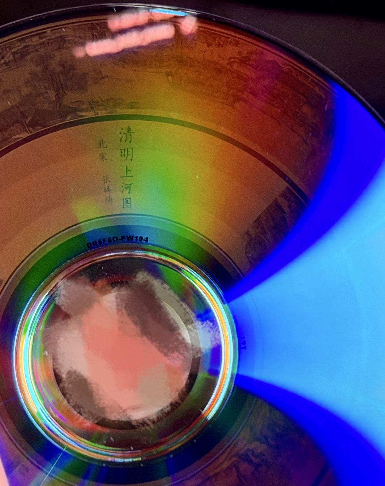
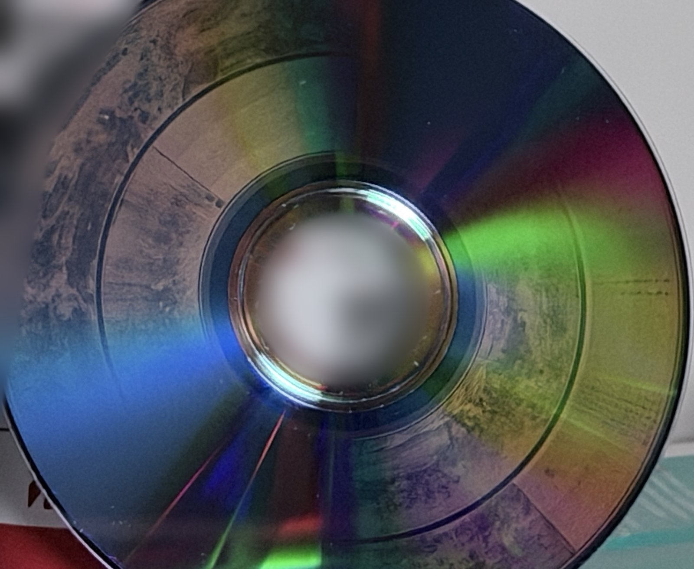
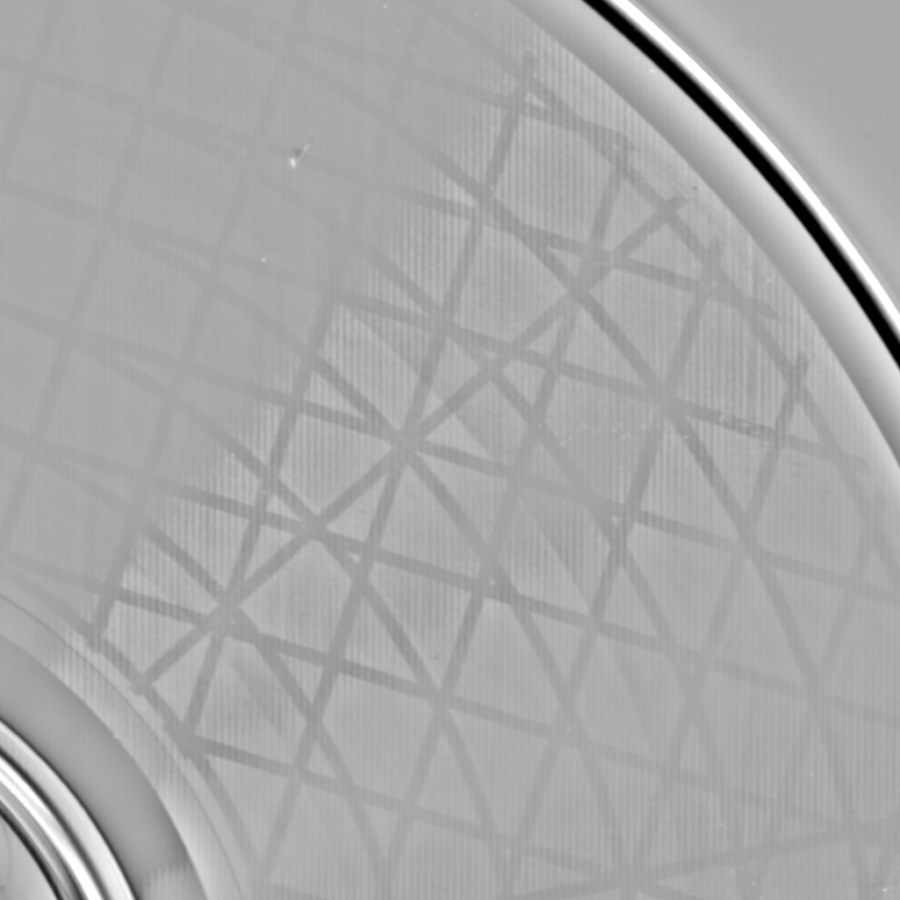
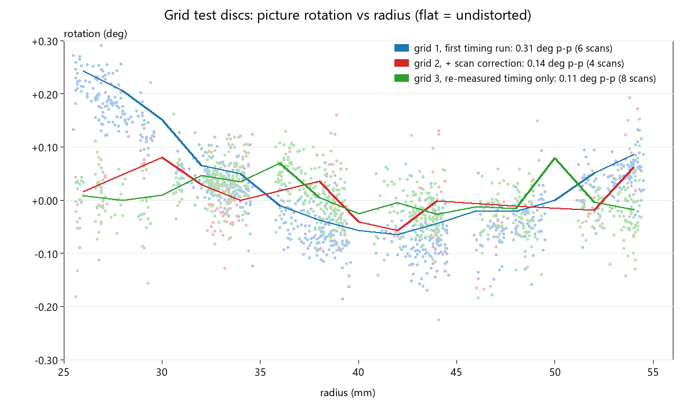
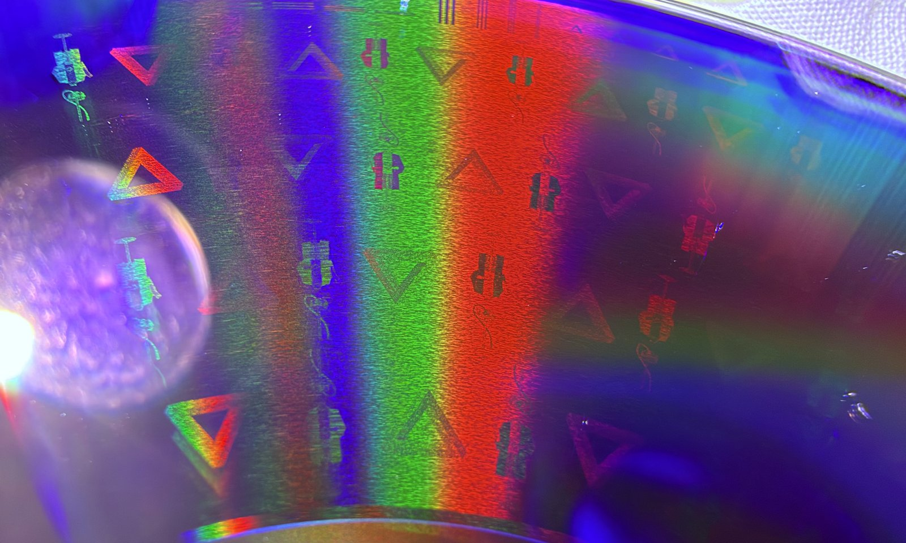
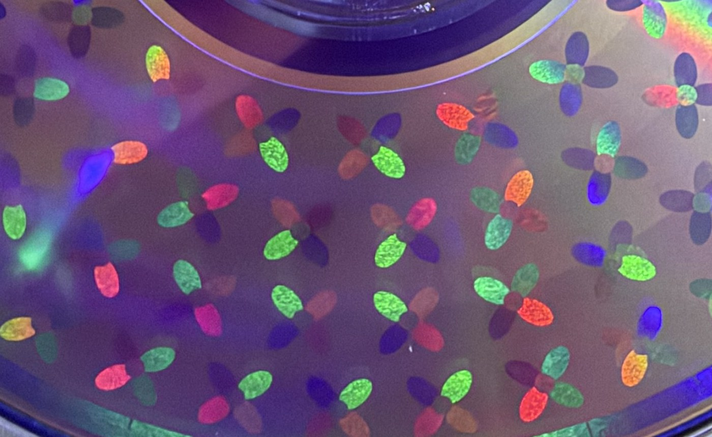

# disc-probe

[English](README.en.md) | 简体中文

让普通光驱自己测出一张盘的螺旋几何，再把图片刻到 DVD-R 或 CD-R 的数据面上。整个过程不用拍照描点。

<p>


</p>

《清明上河图》，刻在 Ritek F1 DVD-R 上，这是直出的结果：几何全部来自读取计时，这张盘只刻了一次，没有试刻、拍照标定或扫描修正。照片是手机拍的，只裁到盘面、缩小并模糊了背景。

## 原理

往数据面刻图，要知道第 N 个扇区落在盘上的哪个角度。每批盘的轨距和位长都有极小的差别，绕几万圈累积下来，图就会扭成漩涡。常见的办法是刻一张标定图，拍照描点，再反复修正。

disc-probe 让光驱来量。盘匀速转动时，一个扇区读完的时刻，就是它转到读取头下的时刻。所以轮流读两个扇区，把完成时间的差换算成角度，就知道它们在盘上隔了多远。一次只能测出 360° 以内的余数，所以从近到远逐级测，每一级都用前面的结果预测整圈数，大约 20 级就能覆盖全盘。

这套测量只发读取类命令。测完可以直接生成 ISO，也可以导出 [DiscImageStudio](https://github.com/JiaFeiMiao-K-Cat/DiscImageStudio) 预设。

## 效果

### 几何精度



这是网格测试盘的局部，600 dpi 平板扫描，高通处理后约 38 mm 见方。这张盘同样只用计时结果、只刻一次（HL-DT-ST GH70N，Ritek F1 DVD-R）。8 张扫描量得 25–54 mm 内的转角峰峰值 0.11°，rms 0.03°。在 50 mm 半径处，0.03° 大约是 0.03 mm。



图中绿线是这张盘。测量方案是[刻录前预先登记](docs/PREREG_remeasure.md)的。

### 细节



密铺盘的微距照片，也是只刻一次。不可能三角形宽 4.2 mm，小人高 6.8 mm，最上方是测线宽用的三线组。肉眼能看清最小的 1 mm 三角形，它每条边约 0.15 mm 宽。600 dpi 扫描能分开 0.12 mm 的线，0.08 mm 勉强，再细就到扫描仪的极限了。

### 颜色（实验中）



花瓣由几种不同的周期纹理组成。颜色来自沿轨道方向的衍射，换个角度看就会变。这部分还在探索，进展在 [Discussion #108](https://github.com/JiaFeiMiao-K-Cat/DiscImageStudio/discussions/108)。

### 其他光驱和盘

- 同一种 RITEKF1 盘上，我们的计时结果和 bczhc 独立的拍照标定（[DiscImageStudio #53](https://github.com/JiaFeiMiao-K-Cat/DiscImageStudio/issues/53)）相差约 ±0.05°。
- 一台约 15 年前的笔记本光驱（PLDS DS8A8SH，SATA 转 USB）测出的几何，和我们的 GH70N 相差约 0.05° rms。
- CMC CD-R 需要多做一步：计时测不出数据沿轨道的绝对位置，要刻一张网格盘来定这个常数。在 GH70N 上它约为 206 帧，用第二张盘验证后只剩 +0.6 帧。这批盘的轨距还有波浪，第二张盘残余 0.16° rms。

## 快速开始

需要 Windows、Python 3.10 以上、一台能刻录的光驱和同一批的几张空盘。Linux 和 macOS 见[实践报告表](#有实践报告的光驱)下方的移植版本。下面以 DVD 为例，CD 的步骤见[使用手册](docs/MANUAL.md#cd-r纹理计时与刻图)。

用**管理员**身份打开终端，安装依赖，并用模拟驱动器确认环境正常。不方便用管理员身份时，在读盘的命令后加 `--transport imapi`：它经 Windows 自带的 IMAPI2 刻录接口（`IDiscRecorder2Ex`）发同样的命令，普通用户即可；默认的 `auto` 在 SPTI 被拒时会自动改用它。

```bash
git clone https://github.com/Ashley-QwQ/disc-probe
```

```bash
cd disc-probe
```

```bash
python -m pip install numpy pillow scipy
```

```bash
python -m discprobe selftest
```

**1. 刻一张随机数据盘。**测量盘必须是普通数据，刻了图案的盘读不出来。用 Windows 自带的光盘映像刻录机刻 `iso/random.iso`。

```bash
python -m discprobe random --output iso/random.iso
```

**2. 看这台光驱能不能用。**约 1 到 3 分钟。结果要是 `CAV`，抖动越小越好。

```bash
python -m discprobe timing --drive H:
```

**3. 测几何。**

```bash
python -m discprobe geo --drive H:
```

有些盘的轨距会缓慢变化，这时 `geo` 会提示残差偏大。比如 RITEKF1 恒定轨距就够，`CMC MAG. AM3` 和一种 RITEK DVD+RW 则要二次修正（残差从 0.38°、0.61° 降到约 0.08°）。看到提示就重新拟合一下，不用再测盘，它会打印各模型的残差。如果二次明显更好，就写出修正文件：

```bash
python tools/geo_polyfit.py results/geo-H-... --write-correction correction.json --order quadratic
```

**4. 生成图片 ISO，刻到同一批的空盘上。**把路径换成上一步输出的 `summary.json`，有修正文件的话再加 `--correction correction.json`。生成后程序会抽查扇区，和设计逐字节核对。

```bash
python -m discprobe image --geo results/geo-H-.../summary.json --picture my_picture.png --output iso/picture.iso
```

想继续用 DiscImageStudio 的话，可以导出预设。`--sectors` 填你这张盘的扇区数，半径范围填 `geo` 实际测到的范围，有修正文件的话同样加 `--correction correction.json`。程序会打印和测量结果的转换误差，先看一眼再刻。目前预设要手动填进 DiscImageStudio：新建工程，填内外半径、扇区数和一二三次项：

```bash
python -m discprobe disexport --geo results/geo-H-.../summary.json --sectors 2298496 --r-min 25.8 --r-max 54.5 --output dis_preset.json
```

看盘时，彩虹"披萨片"是出厂导槽的衍射。在一块小而亮的光源的镜面方向附近看（光源紧挨着眼睛或相机），图像整盘可见。

<a name="光驱兼容表"></a>

## 有实践报告的光驱

这里只列已经有人测过的光驱，没列出的也可能能用，先跑一次 `timing` 就知道。数据大多来自 `timing`。欢迎在 [DiscImageStudio discussion #107](https://github.com/JiaFeiMiao-K-Cat/DiscImageStudio/discussions/107) 补充。

| 光驱 | 接口 / 系统 | 盘 | 缓存 | 转速模式 | 单次抖动 | 备注 | 来源 |
|---|---|---|---|---|---|---|---|
| HL-DT-ST GH70N（NYA2） | SATA / Windows | Ritek F1 DVD-R | `fua` | CAV，4x 约 2830 rpm | 0.43–0.55° | 阶梯和刻图都已验证（首刻约 0.1°）；外圈约 53 mm 处会换转速档 | 本仓库 |
| HL-DT-ST GH70N（NYA2） | SATA / Windows | CMC CD-R | `fua` | CAV，用 `--speed 1411`（约 2080 rpm）；`--speed 2822`（3226 rpm）下 49.8 mm 以外完成时刻晚约 0.2 ms，不能用 | 0.5–0.76° | CD 阶梯可用；这条路径（IMAPI 刻录 + READ(12)）的沿轨道常数约 206 帧，已用两张网格盘验证（第二张残余 +0.6 帧）；这批盘的轨距有约 0.45° 峰峰的波浪 | 本仓库 |
| MATSHITA BD-MLT UJ260AF（1.01） | USB 3.0 / macOS（[discprobe-macos](https://github.com/NaiveTomcat/discprobe-macos)） | RITEK RiDATA 可打印 DVD-R（MID `RITEKF1`） | `fua` | CAV，2364 rpm | 0.65–0.87° | `geo` 和 `disexport` 跑通，参数见 [#87](https://github.com/JiaFeiMiao-K-Cat/DiscImageStudio/issues/87)，已有人用它刻图成功；和本仓库 GH70N 的 Ritek F1 结果在 25–58 mm 相差 0.13° rms（30 mm 以外在 ±0.2° 内）。FUA 重读固定两圈；SET CD SPEED 请求 4x 不换档；建议 `--sectors 16` | NaiveTomcat，#107 |
| HL-DT-ST GP65NB60（PF00） | USB / Windows | 铼德 ExcellentX DVD+RW（`RITEK/004/48`），随机数据 | `fua` | CAV：不加 `--speed` 2355 rpm，`--speed 3324` 1432 rpm，`--speed 11080` 3596 rpm | 1432 rpm 下 0.23–0.29°（26–34 µs），2355 rpm 下 0.53–0.65°，3596 rpm 下 1.07–1.12° | 按角度算抖动很低，建议用 `--speed 3324`。1432 和 2355 rpm 的相位只差 0.17° 以内，3596 rpm 在 52 mm 附近差到 +0.97°。刻标定图案的盘读不出，要用随机数据盘。`geo` 22 级跑通（`--speed 3324`），恒定轨距 rms 0.61°、χ²/dof 10.8，二次轨距降到 0.078°、0.20，说明这张盘轨距有缓慢变化，要带修正。用带修正的预设以 2.4x 刻标定图，径向线只有一点点歪（用户目测）；之前手动刻十几次才看到径向线 | FanJZSS，#107 |
| HL-DT-ST GP90NB70（1.00，IO-DATA 外置） | USB / Windows | VHR12JP53SV4 DVD-R（MID `CMC MAG. AM3`），随机数据 | `fua` | CAV，2355 rpm（`--speed 5540`） | 0.25–0.28°（18–20 µs） | 抖动很低。`geo` 22 级和 `disexport` 跑通。恒定轨距 rms 0.38°，二次轨距降到 0.087°，说明这种盘轨距有缓慢变化。用户[后续反馈](https://github.com/JiaFeiMiao-K-Cat/DiscImageStudio/discussions/107#discussioncomment-19410771)已用恒定轨距预设刻图，机器最高 8x 写速下也能清晰成像（照片待补，尚无量化图像误差）。FUA 重读三圈 | li-yifei，#107 |
| ASUS BW-16D1H-U（E116） | USB / Windows、Linux | RITEK ARITA DVD-R，随机数据；BD-R | `fua` | DVD：CAV，9204 rpm（请求 2770、5540 都不降速）。BD-R：内、中圈约 9705 rpm，外圈约 1655 rpm，第一次运行不稳，判为 mixed | 约 200 µs，不随转速变（DVD 10–14°，BD-R 2–15°） | `geo` 能跑完，但**结果不建议用来刻图**：和 #53 同一批盘的几何比，27–54 mm 有约 9.5° 峰峰的偏差（外圈 54 mm 处 +7.7°），和 50 mm 以外约 0.2 ms 的完成时刻跳变吻合 | bczhc，#107 |
| PLDS DVD-RW DS8A8SH | SATA 转 USB / Windows、Linux（[bczhc/disc-probe](https://github.com/bczhc/disc-probe)） | RITEK ARITA DVD-R，随机数据 | `fua` | CAV，2388 rpm | Windows 0.52–0.88°（36–61 µs），Linux 1.37–1.62°（96–113 µs） | 约 15 年前的笔记本光驱。Windows 上 `geo` 跑通（22 点，rms 0.21°），和本仓库 GH70N 的结果相差约 0.05° rms，和 bczhc 的拍照标定（#53）在 5 个点上差 0.02–0.23°。Linux 上 `geo` 也跑通，和 GH70N 差 0.33° rms（27 mm 处约 −0.85°） | bczhc，#107 |
| ASUS SDRW-08U9M-U | USB / Windows | RITEK ARITA DVD-R，随机数据 | `fua` | CAV，2355 rpm | 0.79–1.08°（56–76 µs） | 和同一张盘在 DS8A8SH 上的 5 个相位差 −0.23、+0.25、−0.67、−0.05、−0.04°；`geo` 待测 | bczhc，#107 |
| HP BD-RE BU20N（LG OEM，0403） | USB / Windows，用 WindowsNoEditor 自己的探测程序 | 联想 Thinkplus CD-R 80 min | 每次先读远处，READ CD 单扇区 | CAV，1241 rpm（`0x0583`）、2482 rpm（`0x0B06`） | 1241 rpm 约 0.45°（约 60 µs），2482 rpm 约 1.3–3.0° | 不是用本工具测的，方法相同；在扇区约 65,600 处测到沿轨道约 +0.2 mm 的接缝 | WindowsNoEditor，#107 |
| Sony Optiarc AD-7201S（1H9K） | Windows | Memorex CD-R（ATIP 97:15:17），随机数据 | `fua` | CAV，2168 rpm（`--speed 2822`） | 0.61–0.68°（47–53 µs） | `geo` 36 级跑通，恒定轨距 rms 0.51°，二次 0.35°，有几个点偏离较大，原因未查。沿轨道常数还没测。`geo` 后再用 DIS 图像法精修，成功出图（之前试约 15 张未成）。读 DVD-R（`CMC MAG. AM3`）时约 7514 rpm，请求 4x 不降速，抖动 1.7–2.1°，内圈更差，恒定轨距 rms 0.51°，二次 0.41° | pugod124，[disc-probe #2](https://github.com/Ashley-QwQ/disc-probe/issues/2) |
| HL-DT-ST SP80NB80（RC00） | USB / Windows | DVD-R（同一张盘在 HP 上读到 MID `CMC MAG. AM3`） | `fua`（约 200 ms，8 圈） | CAV，2355 rpm | 约 236–1714 µs（3–24°） | 噪声太大，`geo` 在第二级停下。`--speed 3324` 也不降速，噪声更大（723–3368 µs），不适合 | Sliicy，[disc-probe #1](https://github.com/Ashley-QwQ/disc-probe/issues/1) |
| HP HLDS GUD0N（SD03） | 内置 / Windows | DVD-R（MID `CMC MAG. AM3`） | `flush`（旧版工具） | CAV，3591–4402 rpm | 约 108–165 µs | 旧版 `geo` 在 LBA 68848 停下，疑似整圈数错；最新版待重测 | Sliicy，[disc-probe #1](https://github.com/Ashley-QwQ/disc-probe/issues/1) |
| PLDS DVD±RW DU-8A5LH | Windows，用 WindowsNoEditor 自己的探测程序 | 海存 POSO CD-R 80 min（ATIP 97:27:18） | 每次先读远处，READ CD | CAV，2032 rpm（`0x06E4`）；`0x0583` 下转速不恒定 | 每级 σ 中位数 0.47° | 阶梯残差 rms 0.73°。和 BU20N 测同一张盘，几何一致，只差一个约 25 帧的沿轨道常数 | WindowsNoEditor，#107 |
| ASUS DRW-24D5MT（1.00） | Windows | DVD+R（MID `MCC/004/0`），随机数据 | `fua` | CAV：`--speed 5540` 2353 rpm，默认和 `--speed 11080` 4747 rpm | 2353 rpm 下 0.49–0.55°（35–39 µs），4747 rpm 下 0.78–0.98° | 两档相位差 0.4° 以内。`geo` 22 级跑通，恒定轨距 rms 0.29°，χ²/dof 2.35 | Disappear9，#107 |
| ASUS SDRW-08D2S-U | USB / Windows | Verbatim CD-R | `fua`（2 圈，57.4 ms） | `--speed 1411` 是 CLV 约 4x；`--speed 4234` 是 CAV，2090 rpm | 0.19–0.28°（15–23 µs），2090 rpm 下 | `geo` 要加 `--media cd` 重跑 | moodyos，#107 |
| ASUS SDRW-08D2S-U（B911） | USB / Linux（bczhc 的移植版） | Verbatim DVD+R（内圈编码 `ZE0460-DVR-T47D`） | 未报告 | 未报告 | 未报告 | `geo` 加网格扫描修正后导出预设，转换误差最大 0.118°，用它刻图成功（用户反馈，无量化图像误差）；另一份 Verbatim 预设对这张盘无效。预设和照片见 [DiscImageStudio #140](https://github.com/JiaFeiMiao-K-Cat/DiscImageStudio/issues/140) | NO-ob，[disc-probe #6](https://github.com/Ashley-QwQ/disc-probe/issues/6) |
| PLDS DVD-RW DU8A6SH | macOS（[discprobe-macos](https://github.com/NaiveTomcat/discprobe-macos)） | 绿联 DVD+R（MID `MCC 004`，内圈 `PR25014-P16`），随机数据 | `fua` | CAV，1796 rpm（`--speed 4155`；2x 和 3x 是同一档，4x 下 `geo` 中止） | 约 0.68–0.83° | `geo` 22 级跑通，rms 1.45°；51.4–52.8 mm 有一段噪声带，不完全复现，去掉后 0.21°，u、v 几乎不变。和 zhajial 对同款盘的 DIS 照片标定（DiscImageStudio #132）相差约 0.15° rms。导出 ISO 用系统刻录（3x）出图正确，DIS 流式刻录选 2x 时出错，原因未查 | ShiroiTree，#107 |

Linux 版由 bczhc 移植：[bczhc/disc-probe](https://github.com/bczhc/disc-probe)（见其中的 `README-linux.md`）。macOS 版由 NaiveTomcat 移植：[NaiveTomcat/discprobe-macos](https://github.com/NaiveTomcat/discprobe-macos)（GPL-3.0-or-later），发布包里带签名、公证过的通用 helper，不需要编译。

## 另一种用法：计时加图像法精修

计时结果不够完美时，也可以只用它把参数带到足够接近，再用 DiscImageStudio 的图像法精修。pugod124 之前试了约 15 张 CD 都刻不好，这样做之后成功出图，详见 [disc-probe #2](https://github.com/Ashley-QwQ/disc-probe/issues/2#issuecomment-6650565706)。

## 局限

同一个 MID 的盘几何也可能不同：两张 `CMC MAG. AM3` 的轨距差约 0.7%。所以别人的预设不一定能用，要量自己这批。

光驱之间差别很大。转速不是 CAV，或者抖动太大（比如 200 µs）的光驱，测出的几何可能不能用，先跑 `timing` 看结果。

高转速读外圈可能出现假象。GH70N 在 3226 rpm 读 CD 时，49.8 mm 以外的完成时刻会晚约 0.2 ms，会被误读成几何，降速后就消失了。

目前实测刻图的只有 GH70N 这一条路径，其他光驱的结果来自计时对比和少数用户的刻盘。

CD 的沿轨道常数要靠网格盘来定，206 帧只对 GH70N 加 IMAPI 刻录、READ(12) 读取这条路径成立。CMC CD-R 在约 33 mm 处还有约 0.4° 的落差，可能是刻录时的接缝，正在核对。

`geo` 目前只支持 DVD 和 CD，蓝光盘只能跑 `timing`。

## 安全

光驱部分只发送读类命令。[`discprobe/scsi.py`](discprobe/scsi.py) 里有一份白名单，白名单之外的操作码在到达设备前就被拒绝，self-test 会验证 WRITE、CLOSE TRACK、FORMAT UNIT 确实被拒。唯一会改变驱动器状态的命令是 `SET CD SPEED`，只在你传 `--speed` 或 `--cav` 时才发送。刻录由 Windows 自带的刻录功能完成，只有 [`tools/burn_imapi.ps1`](tools/burn_imapi.ps1) 加 `-Burn` 时才会写盘。

## 文档

| 文档 | 内容 |
|---|---|
| [使用手册](docs/MANUAL.md) | 每个命令的原理、参数、输出和自检结果，包括辐条盘、纹理环盘、多假设标定盘和 CD |
| [知识汇总](docs/KNOWLEDGE.md) | 方法原理、硬件实测、踩过的坑和结论 |
| [CD 物理模型](docs/CD_PHYSICAL_MODEL.md) | CD 的实现和时序假设 |
| [作品照片](docs/showcase/README.md) | 每张照片对应的盘和刻录方式 |
| [`evidence/`](evidence/README.md) | 原始测量数据和图，可复现 |
| [dis-cd-timing](https://github.com/WindowsNoEditor/disc-probe/tree/dis-cd-timing/contrib/dis-cd-timing) | WindowsNoEditor 的 C# 探测程序、拟合脚本和原始数据（在他们的 fork 里） |

## 前人工作与致谢

用读取计时测扇区角度，并不是这里首创：

- 光盘防拷里的 DPM（Data Position Measurement），SecuROM 4 及以后的版本都在用；
- redump 论坛 2025 年讨论过用 FUA 反复重读同一扇区来测一整圈的时间；
- 飞利浦专利 US7538787B2《在光盘上写入标签的方法》（优先权 2002 年，2017 年失效）已经描述了同样的思路用于在数据区刻可见标签：记录 ECC 块读完的时间戳、用重复读取求转动周期、跳跃距离逐轮加倍。

本仓库做的是：在普通消费级光驱上可复现的开源实现，处理实机的各种问题，用协方差驱动的逐级测量加不确定度估计，做实盘网格验证和跨盘修正，并能导出 DiscImageStudio 预设。

数据面刻图的编码参考了 [DiscImageStudio](https://github.com/JiaFeiMiao-K-Cat/DiscImageStudio)，`discprobe/efmplus.py` 移植自它。感谢 NaiveTomcat 和 bczhc 的移植，以及 bczhc、NaiveTomcat、FanJZSS、moodyos 的实测数据。

## 许可

Copyright (C) 2026 Ashley-QwQ

本程序是自由软件：你可以按照自由软件基金会发布的 GNU 通用公共许可证（第 3 版，或任何更新的版本）重新发布和修改它。发布本程序是希望它有用，但不提供任何担保，包括适销性或特定用途适用性的隐含担保。详见 [LICENSE](LICENSE)。SPDX：`GPL-3.0-or-later`。
