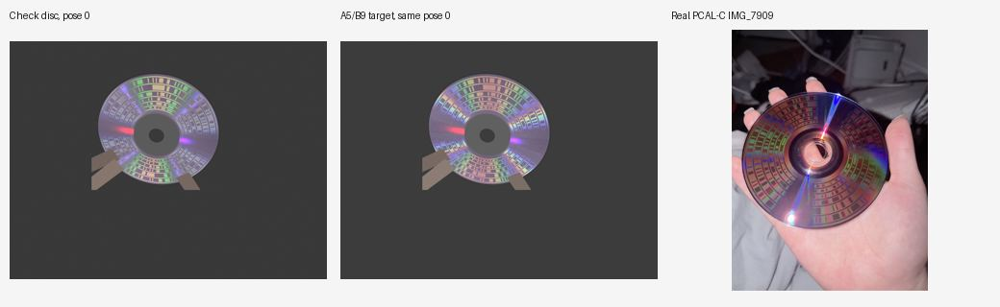
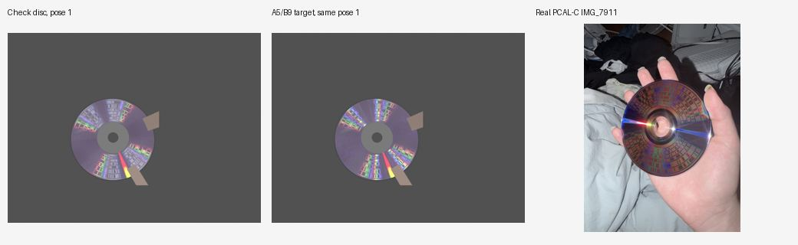
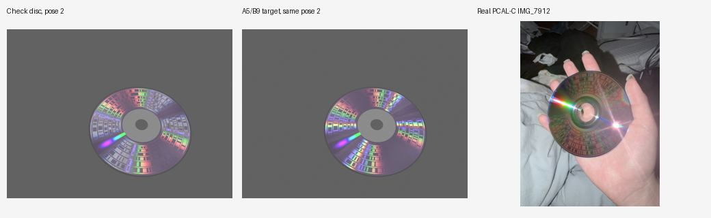

# Disc Lab 任意纹理渲染验证

多字节检查盘现在能画出图案。两张模拟检查盘各拍六张手持照片，默认读取器通过 **4/12（33.3%）**，通过照片的 L 平均绝对误差 **0.0862 mm**，最大 **0.1848 mm**，没有超过 0.326 mm 的错误通过。真实 PCAL-C 的保留结果是 **6/11（54.5%）**；不能据此说模拟照片已接近真实照片。

**A3 v3 是尚未用真实照片验证的预测。模拟颜色不能用于标定真实光盘。** 本次没有为提高通过率调整读取器、门槛、颜色、曝光或多数规则。

## 改了什么

`burnmap.py` 保留原来的单字节代码、RND=256、空白=257，多字节序列另用 uint16 代码，NPZ 内同时保存代码和十六进制配方。ISO 删掉后，纹理身份仍在。带 `.image.json` 的图像按实际记录字节与配方、字节组比较，不把设计当作写入证据；没有 sidecar 时，对记录行内的 128 字节寻找最短的 1–64 字节周期，按行起点恢复相位，无法识别时记 RND。A5/B9/RND 图像保持旧的连续三字节判断，包含边界处的旧行为。

`tables.py` 接上仓库自己的 v3 波动模型。十种 PCAL-C 第二轮纹理的表在 `data/textures_v3.npz`；正常渲染不需要研究源码。未提供的配方需要外部 A3 导出，缺少时明确报错。谱线功率及 XYZ 的缓存键包含配方与完整模型签名；大算子也按签名缓存在仓库和导出目录之外。适配器只在内存中跳过导入时建目录的循环，并补入同一源文件里未改动的 `_hash`，不改源码，也不调用 `build_operator(save=True)`。

A5、B9、RND 继续读取原来的 `data/wave_xyz.npz`，没有重建旧表。新包里也包含 v3 的 RND 供追溯，但运行时仍保留旧 RND 曲线。只有旧三种纹理的 LED 图保持整条旧渲染路径；新旧纹理混合时，旧曲线参与新的面积混合。

`photos.py` 保留相机、翘曲、折射、反射等原有光路。新纹理按记录层坐标的像素雅可比做四个等面积子采样，累计各纹理的 XYZ，再转线性 sRGB，并为整张图使用同一个曝光系数。新路径在 delta 0.10–0.95 以外严格为零。子采样共用像素中心的 delta，仍是有限分辨率近似，不能恢复比极坐标网格更细的图案。

闪光灯默认改为用户确认的 Apple 图纸坐标 **(-43.66, 19.79) mm**，距离约 47.9 mm。34 mm 是原来的误听猜测，不是测量值。`--flash-mm 34 0` 可重现旧机位。六个原有像素哈希明确使用这个旧机位；默认闪光灯照片会因默认机位改变而改变，同一完整机位的 A5/B9/RND 照片仍逐像素一致。

## 验证条件与续跑

Windows、Python 3.13.14。只用虚拟驱动器，未使用真实光驱、网络或服务器。使用 `main-path` 工作树的 `discprobe` 与本分支的 `disclab` 在独立 scratch 中相邻放置；图像生成及默认照片读取最多两个工作进程，流程依次运行。

本次从前次工作继续：沿用 seed=17 的三张 DVD-R、整盘测量盘、默认 `geo`、两张检查盘的保留映射，以及六张保留照片。前次第二张虚拟写入因空间不足中断；保留的 `recovered-readback.json` 记有随后 96 块回读、0 差异、0 不可读。这是前次保留记录，本次没有把它改写成新的成功刻录记录。

本次 A3 源码用本地 `origin/main` 的 `git archive` 重新导出到 D 盘。已有验证目录复制到 D 盘后继续；TMP、TEMP、pytest 临时目录、大算子与光谱缓存、ISO、照片和日志均在 D 盘。单元测试最大 ISO 4096 扇区；多字节区域测试只有两个扇区。比较简化标靶时需要覆盖整盘，因此那一步用 `image --r-max 58` 生成与检查盘同样的 2295104 扇区 ISO，提取映射后立即删除。最初脚本沿用了检查盘的扇区数去读较短的默认图像，触发越界；随后误用了 `image` 不支持的 `--sectors`，均保留为失败日志，没有纳入成绩。提取器补上异常时的 ISO 句柄释放，并有 Windows 删除文件的回归测试。

默认 `geo` 的保留结果为 `target_reached`：u=180518.62770873442，v=5.591208554302128，覆盖 24.640–57.714 mm，残差 RMS 0.08097°。两张检查盘从该几何得到的真值 L 分别为 **+0.1902183、+0.1895018 mm**，包含当前物理模型实际使用的写入偏移，未用照片估计值代替真值。

所有手持机位使用 `default_rng([20261113, disc_index])`，每张照片保存完整 pose。这组随机种子恰好使十二张都采用室内灯，所以改闪光灯坐标不应影响这些照片。另增加每张盘两张、共四张相同机位的强制闪光灯配对实验；它是小样本敏感性检查，不是另一次真实验证。

简化标靶由 `disclab.target` 生成，通过同一个 `image` 路径写出。它使用相同的两张盘真值、几何、写入偏移和十二个机位，只在独立对照期间替换映射；`finally` 恢复原始检查盘映射。因此比较包含了标靶设计差异与旧/新光谱路径差异，不能单独归因于其中一个因素。

## 结果

| 条件 | 通过 | L 绝对误差均值 mm | 最大 mm | 错误通过 | 应用的组 |
|---|---:|---:|---:|---:|---:|
| 检查盘，Apple 默认，手持 | 4/12 (33.3%) | 0.086211 | 0.184827 | 0 | 1/2 |
| 检查盘，34 mm，手持 | 4/12 (33.3%) | 0.086211 | 0.184827 | 0 | 1/2 |
| 简化 A5/B9，Apple 默认，手持 | 9/12 (75.0%) | 0.051924 | 0.138287 | 0 | 1/2 |
| 检查盘，Apple 默认，强制闪光 | 1/4 (25.0%) | 0.018920 | 0.018920 | 0 | 0/2 |
| 检查盘，34 mm，强制闪光 | 2/4 (50.0%) | 0.185130 | 0.250181 | 0 | 0/2 |
| 真实 PCAL-C，保留记录 | 6/11 (54.5%) | 未知 | 未知 | 未知 | 1/1 |

错误通过沿用原来的严格条件：照片 `status=ok` 且 |估计 L−真值 L| > 0.326 mm。拒绝照片没有被当作 L=0。组结果仍由原来的多数/机位规则决定，单张通过不能直接当成一组应用。

检查盘 1：3/6 通过，组应用 L=+0.0374559 mm，对真值误差 −0.1527624 mm。检查盘 2：1/6 通过，`one_photo_provisional`，组不应用 L。合计拒绝原因：`too_few_votes` 4、`poor_angle_coverage` 2、`no_rim` 2。读取器出现的平方根/空切片数值警告保留在日志中，没有据此改读取器。

简化标靶的 9 张通过照片也没有全部转为组应用：盘 1 保留 `ambiguous_majority`，盘 2 应用 L，绝对误差约 0.0247 mm。较高的单张通过率没有绕过原来的组规则。

十二张室内灯照片在两种偏移下 JPEG SHA-256 逐一相同，读取结果完全相同：通过率变化 0 个百分点，L 变化为 0。这个结果只说明室内灯与闪光灯参数独立。

强制闪光的四对照片如下。两种偏移以外的参数及随机数完全相同；拒绝结果保持拒绝。

| 盘 / 机位 | Apple 状态 | Apple L mm | 34 mm 状态 | 34 mm L mm | 同张均通过时 ΔL (34−Apple) mm |
|---|---|---:|---|---:|---:|
| LAB-A 1-02 / 0 | ok | 0.171298 | poor_angle_coverage | 0.174744 | 未知 |
| LAB-A 1-02 / 1 | poor_angle_coverage | 0.136105 | ok | -0.059963 | 未知 |
| LAB-A 1-03 / 0 | poor_radius_coverage | -0.116166 | too_few_votes | 未知 | 未知 |
| LAB-A 1-03 / 1 | too_few_votes | 未知 | ok | 0.069423 | 未知 |

强制闪光通过率从 1/4 变为 2/4，变化 +25.0 个百分点。通过样本的平均绝对误差从 0.018920 mm 变为 0.185130 mm。若通过的机位不同，这不是同一照片 L 的变化。样本仅四对，两组均没有强制应用 L，不能据此选偏移或声称真实精度。

真实比较来自保留的 `docs/goals/pcal-2026-11-12/run/photo.json`：6 个 `ok`、4 个 `too_few_votes`、1 个 `poor_angle_coverage`；通过照片 L 范围 −0.01746 至 +0.31751 mm，组应用 +0.1632654 mm。真实盘缺少独立 L 真值，因此其误差和错误通过数记为未知，不借模拟真值计算。此次未重新读取那十一张原图。

## 模型和假设

v3 用真实 EFMPlus、扰码、ECC、DSV，在八个编码块上平均谱线功率，计算所有衍射级次。仍假设矩形标记宽 0.35 µm、边缘高斯宽 0.03 µm、固定源/瞳孔角孔径、标量波动，以及两种给定灯谱；不包含真实染料的复振幅、多层矢量光学、偏振和实际邻域内容。算子采用对称入射/观察几何，渲染时用本机位的沿轨 delta 查询，不是完整的任意入射角电磁求解。

零级反射保留每张盘的 `zero_order_dark`：A5 系数 1，B9/RND 系数 0.4。新配方用 **0.4 × 标记密度 / B9 标记密度**，这是延续旧规则的假设，不是从波动模型推出的反射率。八块平均密度 A5=0.500003635、B9=0.499997173，十种配方为 0.499996365–0.500004039；DSV 几乎平衡了密度，不能用它解释 A5/B9 的旧亮度差。

`tex_gain`、旧表参照亮度、零级暗化、降饱和、整图 98% 分位曝光、噪声、模糊和 JPEG 也是模型选择。新曲线没有按读取器结果重新缩放。四次采样只是面积份额近似，polar 网格为 0.05 mm × 0.05°；20 µm 设计细节会丢失。CD/BD 的记录字节光学闭环不在验证范围。

与 `discprobe.simulate.along_track` 比较时，在相同的平面点、相机与灯位置，300 个点的沿轨分量差小于 5e−16；核对的是同一几何量的公式。折射、翘曲和 recording-layer 位置变化的整条光路并没有因此得到真实照片验证。

## 表、测试和可查记录

- 导出提交：`1e5786afd832f1df0cd9abe819d14b838518f4a6`。
- 完整模型签名：`9ed29f33fc8edf9967e51e1cecd4f63cb8f39690befa8209abc568d6f3946d14`，源码逐文件 SHA-256、灯谱及积分参数见 `data/textures_v3.json`。
- 新表 SHA-256：`25ec19f51dd3b441d25529d7837a41f6d93099fa4455a768323dea5a847ba75b`（649214 字节）。
- 旧 `wave_xyz.npz` 未改，SHA-256：`ff1d9ba95a7bf7f8d69124dad38d695f0a891044ed2459c8e2c4378db2e212c4`。
- 六个保留哈希另与提交前 `HEAD:disclab/photos.py` 独立计算核对，全部相同，未重写期望哈希。
- `A37062` 独立重编八个块，直接经 `rebin_power`、`xyz_from_mass` 计算，与随包 XYZ 在 rtol=6e−8、atol=1e−10 内一致；没有复用谱线功率 checkpoint。
- 周期分类、行相位、sidecar/无 sidecar、旧边界规则、delta 边界、缺少新配方源码、两扇区提取后删 ISO 再渲染，均有测试。
- 测试：`python -B -m pytest disclab/tests -q`：**48 passed**，50.02 秒；显式 A3 源码可用，直接模型核对没有跳过。
- 小型逐照片数字与输入哈希见 [render_results.json](docs-img/render_results.json)。完整图、pose、原读取结果及续跑脚本留在 scratch 的 `render/validation/`，其中 `validation.log` 是原日志，`resumed.log` 是续跑日志，`resumed-output.log`、`simple-final-output.log` 与 `flash-output.log` 是进度/警告。

## 缩略图

每行从左到右为模拟检查盘、同机位简化 A5/B9 标靶、真实 PCAL-C。只缩小和按 EXIF 转正，没有调整颜色或对比度。真实照片不与模拟机位配准，不能拿这些缩略图做颜色或几何标定。

