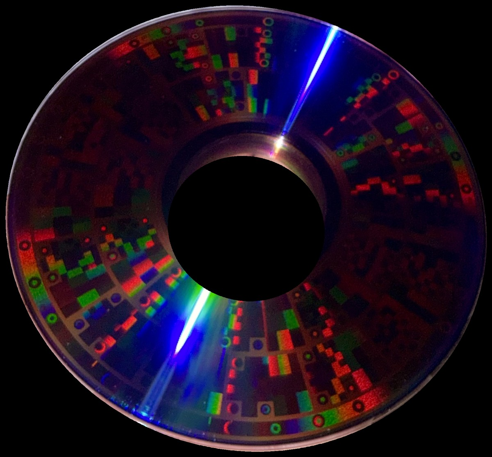
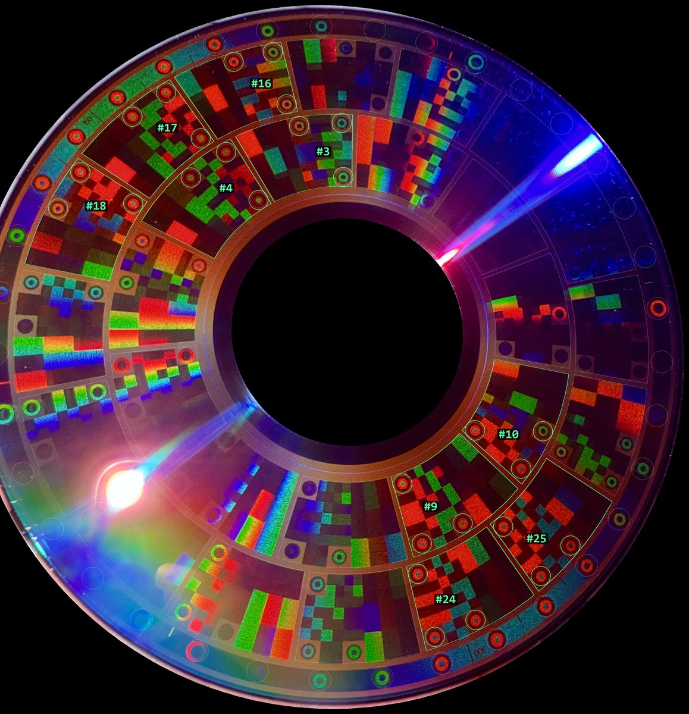
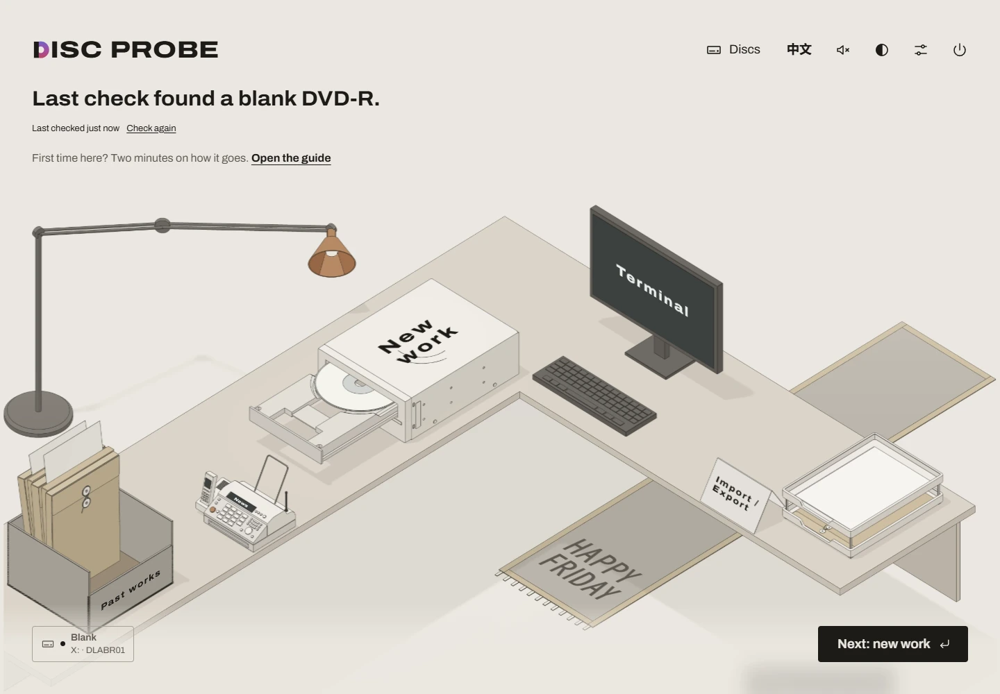
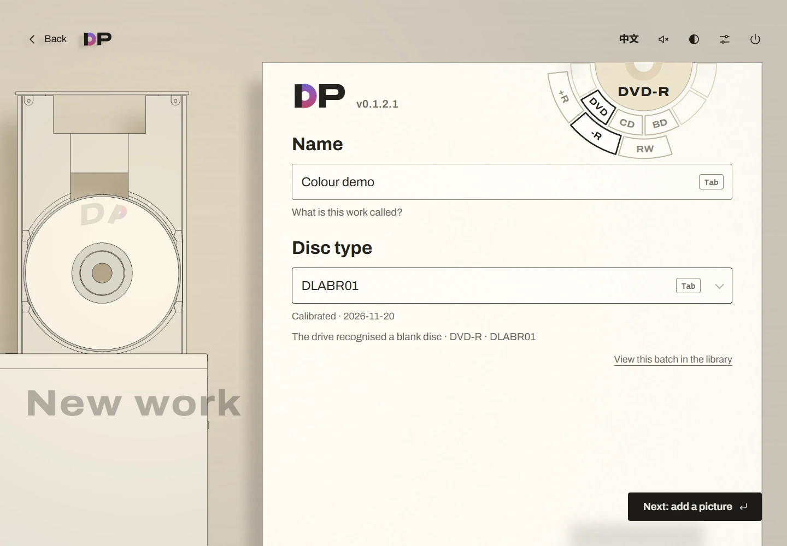
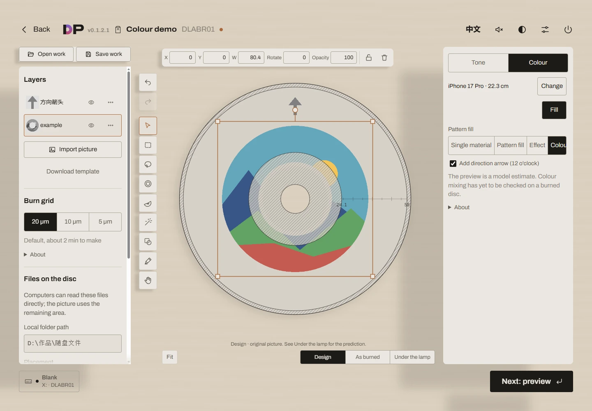
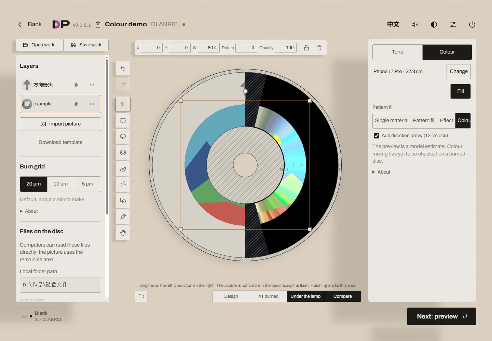
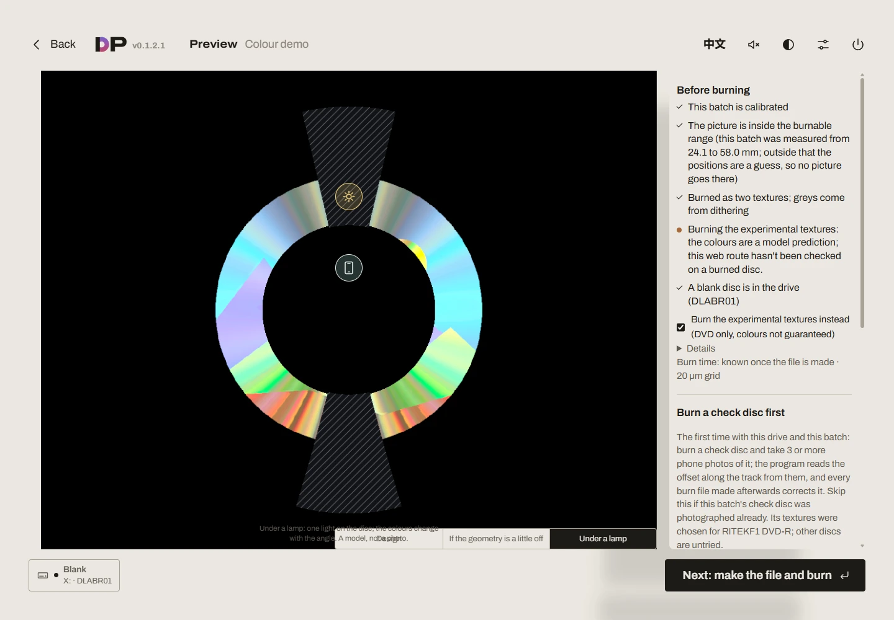
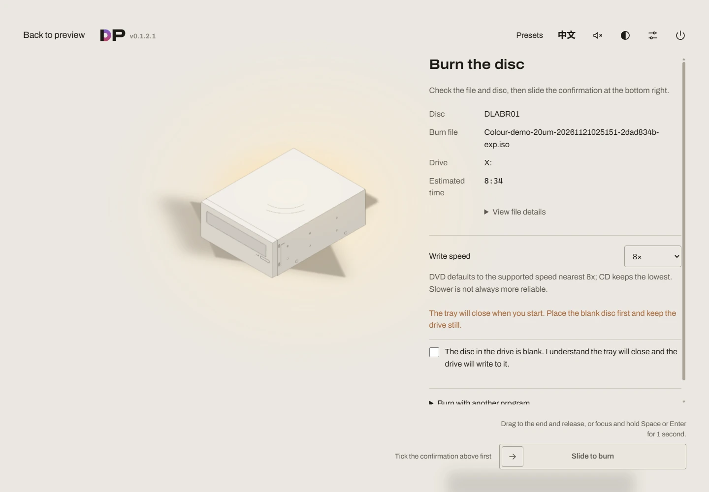
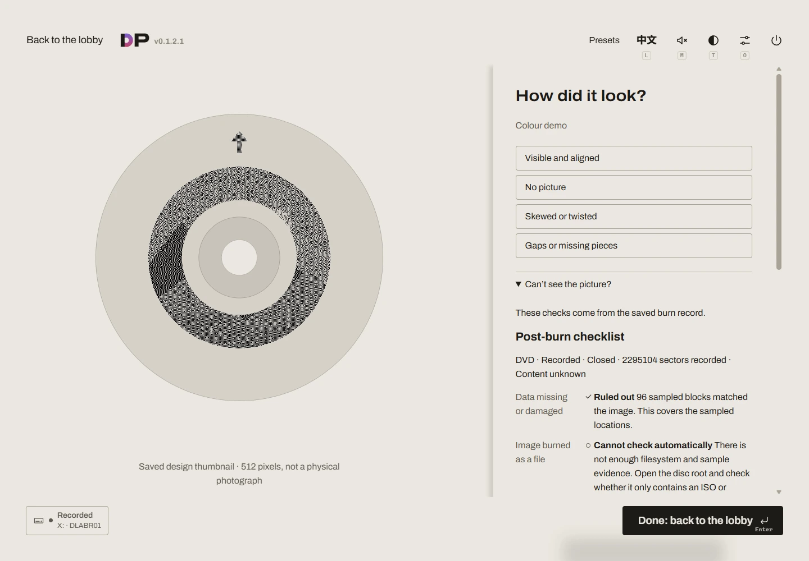

# Make a colour DVD

[简体中文](colour.zh.md) · [README](../README.en.md) · [Why calibrate before burning a picture?](why-calibrate.md)

disc-probe can put a photograph or illustration on the data side of a DVD. Start with a picture that has distinct shapes and large areas of colour. [Download the example PNG](colour-guide/example.png) to follow either workflow below.

Keep the embedded ICC profile when exporting Display P3, Adobe RGB or Rec.2020 artwork. The web editor and `colour-design` convert the image to sRGB and show which profile they used. RGB matrix and tone-curve profiles keep all 16 bits of tagged PNG samples through conversion. An unreadable or unsupported profile triggers a notice and sRGB fallback. Untagged pictures are read as sRGB.

## What the disc will look like

Writing the same bit pattern repeatedly makes a patch of the track act as a **diffraction grating**. It sends different wavelengths of white light in different directions. The repeat length controls which colour reaches your eye or camera at a given angle. disc-probe uses a table fitted from photos of six test discs and chooses among 58 textures for each cell of the picture. Even two patches of the same colour may need different textures because they sit at different angles to the flash and camera.

The **design position** is the setup used to choose those textures. It includes the height and position of the main camera, the flash position and the orientation of the disc. Move the phone a little or turn the disc and the colours can shift, fade or change across the picture. Use a stand for colour you can reproduce. By hand you can find the picture by slowly tilting the disc, but expect the colours to move with it.

 

These photos show a real colour test disc. Several colours are visible together, but some patches are dark and the bright reflection hides parts of the disc. Expect a darker, often less saturated image than the model preview, with bands of colour or glare. Small text, smooth gradients and skin tones are harder to reproduce. Physical colour has been verified on **RITEKF1 DVD-R with a GH70N**. Other media (including RW) and other writers are unverified for this colour workflow. The web export and the `vivid` mapping have yet to be compared with real burns.

## In the web app

The screenshots show the paper theme and a Disc Lab virtual drive. On real hardware, use a blank DVD-R from the batch you measured with the same drive. [Open the web app](../README.en.md#web-page) as described in the README.

1. In the lobby, choose **New work**.

   

2. Name the work, choose **DVD-R** and select your batch. Continue to Design. A batch you choose later can be used for layout, but the preview will ask you to pick or calibrate one before making the file.

   

3. Choose **Import picture**, select its layer, then choose **Colour → Colour picture**. Pick your phone and shooting height, then choose **Fill**. Leave **Add direction arrow (12 o'clock)** checked. In **Design**, check that the arrow is visible and keep important parts of the image outside the hub. The left panel lets you change the **Burn grid**.

   

4. Open **Under the lamp**, then **Compare**. The original is on the left and the prediction on the right. The hatching shows the band where the model cannot show colours at this position. Move any important detail out of that band or choose another shooting height and apply **Fill** again.

   

5. Choose **Next: preview**. Check the batch and measured range under **Before burning**. With a visible colour picture, **Burn the experimental textures instead** is selected by default. Keep it selected for colour. If the batch needs calibration, follow the prompt and return to the work. The separate **Burn a check disc first** option uses photos of a dedicated target to correct placement along the tracks. Then choose **Next: make the file and burn** to make the artwork ISO and move to its burn screen.

   

6. At the burn screen, confirm the writer, the blank disc and the speed. Start with the supported speed nearest **8×**, which the page selects for DVD. Check the consent box, then drag the **Slide to burn** control at bottom right. Writing a DVD-R is permanent.

   

7. After the write, open **Next: how did it look?** and review the sampled read-back. Put the disc data-side up, align its arrow and take a photo with your phone's **1× main camera** and flash, following the setup below. Record what you actually see. The image on the result page is a saved design thumbnail.

   

## Set up the phone and flash

Put the disc flat on a dark surface with the data side up. Keep room lights and bright reflections out of the shot. Align the arrow on the disc with 12 o'clock on the [placement sheet](../tools/make_rulers.py). Set the main lens **28.45 mm toward 12 o'clock from the centre of the disc**, directly above the sheet's cross. Keep the camera parallel to the disc. Rotate the phone so the flash sits farther toward 12 o'clock along the same line. At the iPhone 17 Pro preset, the flash lands about 76.4 mm from the disc centre. For a different phone, mark the flash point using its own lens-to-flash distance.

Use the height you selected, measured from the **table to the lens**, and set the flash to **On**. The starting height in this guide is **22.3 cm**. For the iPhone 17 Pro, the printed 4:3 photo placement sheet has grid lines for the reference framing. Print at actual size (100%) and use the printed scale bar to check it. For other heights or phones, use the measured lens and flash positions and a ruler for height. With a stand, adjust one thing at a time, such as height or the disc's rotation, then return to your design position. If you must shoot by hand, use the same marks and take several frames close to that position.

| Phone | 1× lens to flash | Setting |
| --- | ---: | --- |
| iPhone 17 Pro | **47.9 mm** | `iphone17pro` preset. [Apple drawing, Detail D](https://developer.apple.com/download/files/accessories/dimensional-drawings/iphone-17-pro.pdf#page=2) |
| iPhone 17 Pro Max | **53.6 mm** | Custom, 54 mm. [Apple drawing, Detail D](https://developer.apple.com/download/files/accessories/dimensional-drawings/iphone-17-pro-max.pdf#page=2) |
| iPhone 17 | **19.0 mm** | Custom, 19 mm. [Apple drawing, Detail D](https://developer.apple.com/download/files/accessories/dimensional-drawings/iphone-17.pdf#page=2) |

The distances are calculated from the horizontal and vertical offsets in the drawings. For the 17 Pro those offsets are 43.66 mm and 19.79 mm. The two custom entries give physical distances and have no colour test results in this guide.

To measure another phone, open its rear camera at 1× in good light and identify the active lens by briefly covering each candidate while watching the viewfinder. Measure from the centre of that lens to the centre of the flash in a straight line across the back. A clear ruler or a straight-on photo of the back with a scale in the same plane works. Round to the nearest millimetre and use **Custom** (10–60 mm). Keep the lens and flash lined up with 12 o'clock as above, even if that calls for rotating the body of the phone.

<details>
<summary>Generate the printable placement sheet</summary>

Run `python tools/make_rulers.py --out rulers` from the source checkout with Matplotlib installed. `--out` sets the destination (the script's default is `D:/dp-dev/tmp/focal`). In `rulers/dp_rulers_1x_new_letter.pdf`, page 1 is the height ruler and page 2 is the photo placement sheet. The placement page still carries the old 21 cm label. Use the 22.3 cm height on page 1 for this example. The cross and disc outline are useful regardless of phone. Use the grid lines and flash dot only for the reference framing and flash spacing.

</details>

## From the command line

Run the commands in an empty working directory where both `python -m discprobe colour-design --help` and `python -m discprobe burn --help` work. Save the [sample](colour-guide/example.png) there as `example.png`, or use your own picture.

### 1. Measure this batch

If you have a good geometry run for this drive and batch, keep its path and go straight to step 2. Geometry is the map from sectors to positions on this disc. Look up existing runs with `python -m discprobe results geo`. To measure a new batch, use a blank for the measurement and reserve another blank of the same batch for the artwork. Replace `X:` with your drive (for example `H:` on Windows or `/dev/sr0` on Linux).

```sh
python -m discprobe info --drive X:
python -m discprobe random --output random.iso --sectors 2295104
python -m discprobe burn --drive X: --iso random.iso --yes-write
python -m discprobe timing --drive X:
python -m discprobe geo --drive X: --ranges 0-2295088
```

- `--drive` selects the drive. The terminal may select the only drive automatically for read commands. `burn` always requires a drive and an `--iso` path. `--yes-write` explicitly authorizes the write. Confirm the actual drive and blank before running it each time.
- `random --sectors` is the length to write. The DVD default is 2,295,104 sectors (4.70 GB). Use the writable capacity shown by `info` if lower. `--output` names the ISO, with `iso/random.iso` as the default.
- `timing` checks that the drive reads with stable rotation. Look for a CAV result, meaning constant angular velocity. `geo --ranges` chooses readable sector intervals. The example measures nearly the full recorded disc and ends on a 16-sector boundary before the end of the image. If you wrote a shorter ISO, substitute the last aligned sector inside it. The DVD default is 3–85% of the recorded area. Wider coverage lets you place artwork closer to the edges if the drive reads there cleanly. A failing edge may require a narrower range and a smaller design. DVD geometry measurement requests 4× **read** speed by default. Read the summary's measured intervals and follow any read-speed or grid-check warning before trusting them. [Measurement manual](MANUAL.en.md)

### 2. Make a prediction

```sh
python -m discprobe colour-design example.png --phone iphone17pro --height 22.3 --fit disc -o work.json --preview preview.png
```

Open `preview.png` before making the ISO. Check the picture at the height you can actually hold or mount the phone, with the arrow in place. The preview predicts the colour at that position. If the desired colours change with the position, rerun this step after choosing a different position.

| Option | Default and when to change it |
| --- | --- |
| `example.png` | Required input image. Start with a high-contrast PNG or JPEG. PNG transparency can keep artwork out of the hub or unmeasured radii, as in the example. |
| `--phone`, `--height` | Both required. `iphone17pro` uses its preset flash distance. `--height` is in centimetres above the table, with 22.3 cm as the example. More distance changes where the colours can appear and makes the disc smaller in the photo. |
| `--flash-mm` | Unset for a named preset. Required with `--phone custom`. The CLI rounds the centre-to-centre distance to a whole millimetre and accepts 10–60 mm after rounding. |
| `--fit` | `disc` (default) fills the disc and can crop the image at the hub or rim. `ring` fits the whole image above the hub, giving it less space. Both fit to the nominal DVD layout. Check the measured range before generating. |
| `-o` / `--out`, `--preview` | A work JSON destination is required. The optional PNG path writes a 600 × 600 prediction. Omitting it saves preview time. Keep it for the first pass or after changing the design. |
| `--mapping` | `perceptual` (default) balances hue, saturation and local contrast using the fitted table. Try `vivid` for more visible colour and prefer the result only if the preview suits your picture. It favours brighter textures, which can shift pale or dark colours and soften tonal differences. It needs a fitted table. Its gains are model predictions. |
| `--dither` | `ordered` (default) uses a repeating 8 × 8 grid to mix nearby candidates spatially. `nearest` chooses a single best match without that mix, which can reduce the visible pattern at the cost of coarser transitions. |
| `--no-arrow` | Off by default, so the 12 o'clock mark of random data is added, normally from radius 43.5 to 52.8 mm. Keep it for discs you will photograph or film and check it in **Design** or **As burned**. |

<details>
<summary>Choose a texture library or a custom colour table</summary>

Use the bundled 58 candidates and fitted table for an initial burn. The optional texture library is a read-only catalogue of additional repeat patterns. Its `--texlib` path defaults to `DISCPROBE_TEXLIB` when set. To explore a local library, run `python -m discprobe textures --texlib /path/to/library find --help`. A large library can show predicted textures that have never been burned. Favour candidates built for your material and lighting setup, with measured colour where available.

To change the candidates for an automatic colour picture, give `colour-design --materials candidates.json --table colour-table.npz`. The JSON selects candidate texture specs and the NPZ gives their colour response by angle. The defaults are the bundled set and table. `DISCPROBE_COLOUR_MATERIALS` and `DISCPROBE_COLOUR_TABLE` can override them. Use the same explicit `--table` for `compose` and keep the specs the work saved in their original order. Give `image --texlib` the same catalogue if any output spec needs a library lookup. Changing the candidates or the table changes the prediction and can take you outside the calibrated colours, so preview again. The [bundled material set](../discprobe/colour_print/materials.json) shows the JSON format.

</details>

### 3. Turn the work into a checked ISO

Copy the path to the matching `geo` folder or its `summary.json` into the last argument. The Python command works in PowerShell and POSIX shells. It reads the texture order from the manifest next to the grid and passes each spec as a separate argument.

```sh
python -m discprobe compose work.json --out design.npy
python -c "import json, subprocess, sys; from pathlib import Path; specs = json.loads(Path('design.textures.json').read_text(encoding='utf-8'))['textures']; subprocess.run([sys.executable, '-m', 'discprobe', 'image', '--geo', sys.argv[1], '--design-npy', 'design.npy', '--textures', *specs, '--r-max', '58', '--output', 'colour.iso'], check=True)" "results/geo-X-YYYYMMDD-HHMMSS/summary.json"
```

- `compose` requires a work JSON and an `--out` array path. It writes a material number for each cell to `design.npy` and the matching texture order to `design.textures.json`. Keep the two together.
- `image --geo` is required. Use an explicit run to avoid picking a different batch with `latest`. `--design-npy` supplies the material grid and `--textures` supplies one repeat pattern per material number. If the design reaches outside your measured interval, measure further on the same measurement disc where readable, or fit a smaller design and preview it again. The web editor can clip to the selected batch's measured ring.
- `--r-max` sets the outer radius used to size the ISO. DVD `image` defaults to **56 mm**. This example uses 58 mm to keep the nominal artwork ring available where measured. A larger radius can increase the file size, up to the writer's DVD limit. If the ISO exceeds the blank's writable capacity, lower the radius, allow for outer artwork to be cut, and check the new file's sector count.
- `--output` sets the ISO path. Without it, `image` uses `iso/grid.iso`. For the current ISO, check that `colour.iso.verification.json` says `passed` and corresponds to its size and modification time. This is the writer's sampled check of the ISO against the design.

<details>
<summary>20, 10 or 5 µm grid</summary>

A cell is the smallest square in which you can choose a texture. Smaller cells sharpen edges and can preserve finer detail from a sufficiently sharp source. A patch still needs many repeated marks to make visible colour. The figures below are the editor's planning estimates for composing and generating a full DVD, rounded from benchmark runs. They exclude making the preview and physically writing the disc. A busy machine or slower storage can make generation take several times as long.

| Cell size | Grid across the 120 mm disc | Time | Peak memory to budget | Use |
| --- | ---: | ---: | ---: | --- |
| 20 µm (default) | 6,000 × 6,000 | ~2 min | ~1 GB | Start here for large colour blocks and first attempts. |
| 10 µm | 12,000 × 12,000 | ~4 min | ~2 GB | Finer edges and small details when the source has them. |
| 5 µm | 24,000 × 24,000 | ~10 min | ~5 GB | Finest edges, with the largest time and memory cost. Individual 5 µm cells cannot show colour on their own. |

Choose the grid in the editor before saving the work. For a CLI-generated work, set its top-level `cell` to `0.02`, `0.01` or `0.005` in millimetres before running `compose`. `colour-design` creates a 20 µm work and has no grid option. `image` infers the grid from the array dimensions. If you also give it `--cell-um 20`, `10` or `5`, the value must match the array and cannot resample it. Keep the same geometry and textures when comparing grids.

</details>

### 4. Write the artwork disc

Swap in a fresh blank DVD-R from the measured batch. Check that `info` reports an empty disc with next writable address zero and enough writable sectors. Then authorise the write.

```sh
python -m discprobe info --drive X:
python -m discprobe burn --drive X: --iso colour.iso --yes-write
```

`--speed` is a write speed in multiples of 1×. For DVD, omitting it selects the supported speed nearest 8×. Start there. At 4×, the outer part of a texture test disc written on GH70N and RITEKF1 was unreadable. If the write or read-back failed, review the burn report for where it failed and check which speeds the drive supports for that disc before deciding on a new attempt. Leave verification enabled (the default). Check the reported counts of matching, differing, unreadable and untested blocks. A passing sample checks data at those points. Use the phone setup above to judge the picture.

## Common problems

- **The colours are off.** Start with the 12 o'clock arrow, 1× lens, flash direction and lens height. Keep the disc flat and the room dim. If the colours change with a small movement, fix the phone and disc in position before changing the design.
- **I can see only one colour.** Make sure the experimental textures were enabled. Move slightly around the designed position, watch where more patches become visible, then return to the marks. If the main subject sits in the hatched band in **Under the lamp**, move it to one side and fill again.
- **The preview and the disc are different.** Compare **Under the lamp** at the same position. The model describes diffraction from the selected textures and can look brighter than the disc. Real lighting, the disc's surface and camera exposure add variation. Twisted edges or missing bands can also come from geometry or a write problem. Check the measured coverage and the sampled read-back before changing colour settings.
- **I changed discs or drives.** Measure again on a blank from the new batch, even if the media code is the same. Start with a small set of broad test patches and check both the photograph and read-back before committing a full design. The bundled colours can shift on other DVD-Rs or RW media.

<details>
<summary>Appendix for agents</summary>

Check the installed CLI help, drive and batch, measured coverage, phone and height, texture source and visible 12 o'clock arrow. Show the model preview and get approval before composing the ISO. Check the current verification receipt. Get separate, explicit approval for the specific ISO, drive and blank before any physical write, then report the sampled read-back counts. [disc-colour skill](../skills/disc-colour/SKILL.md)

</details>
