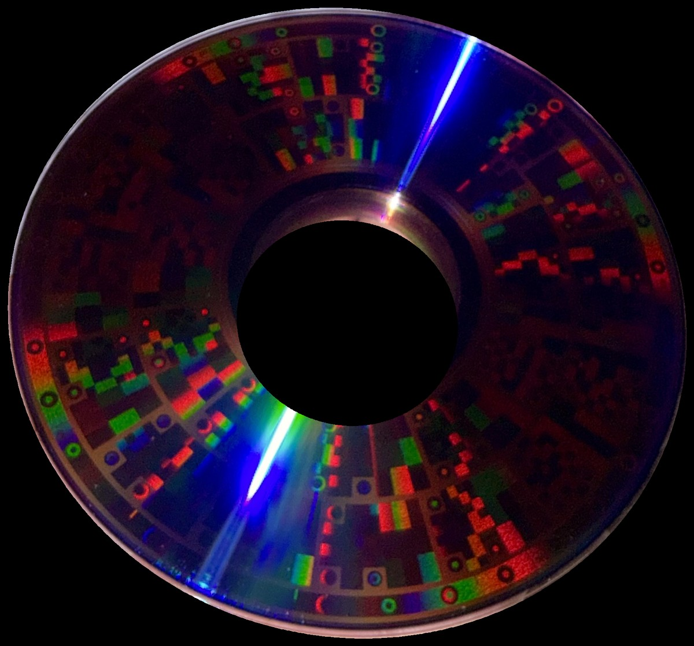
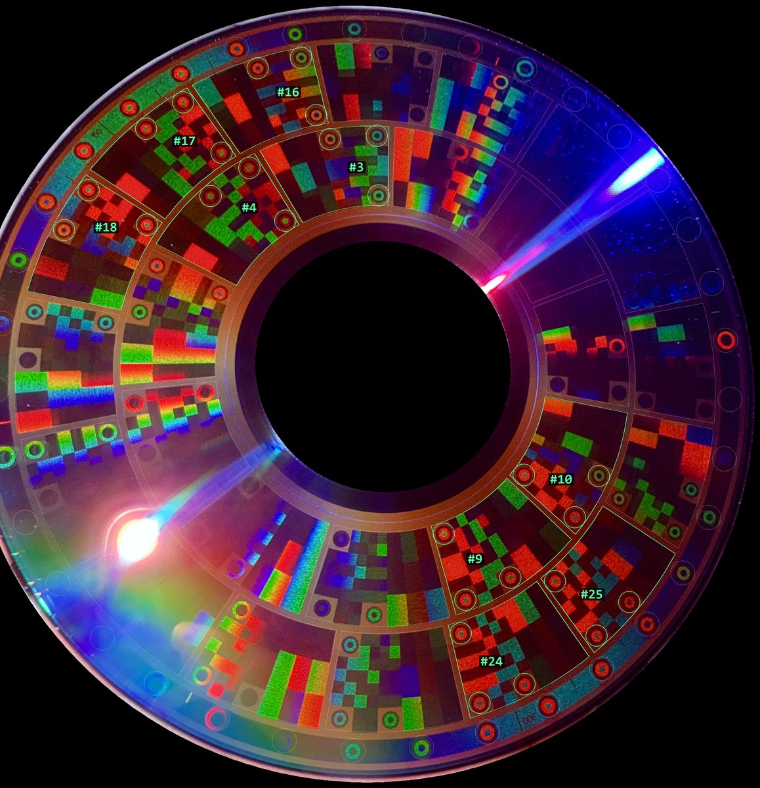
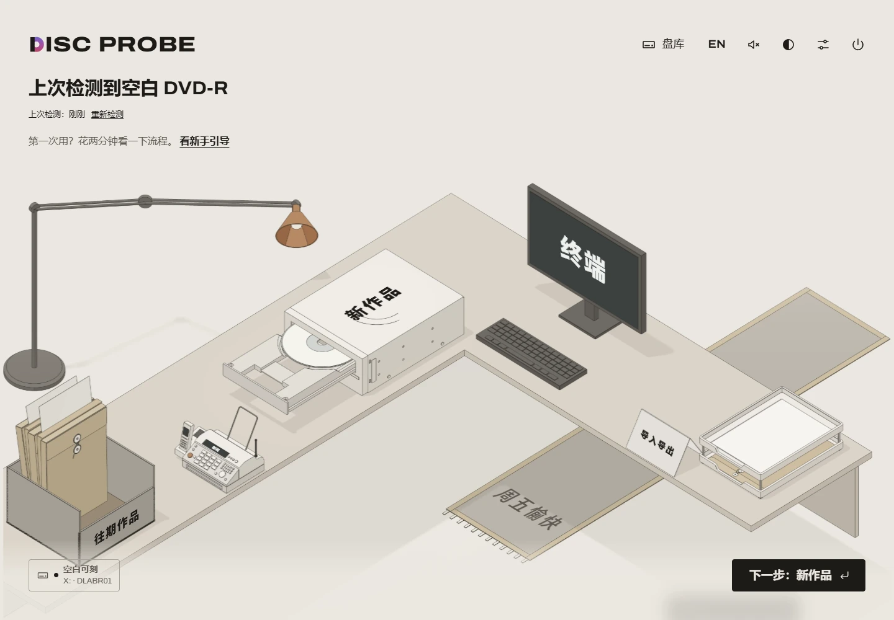
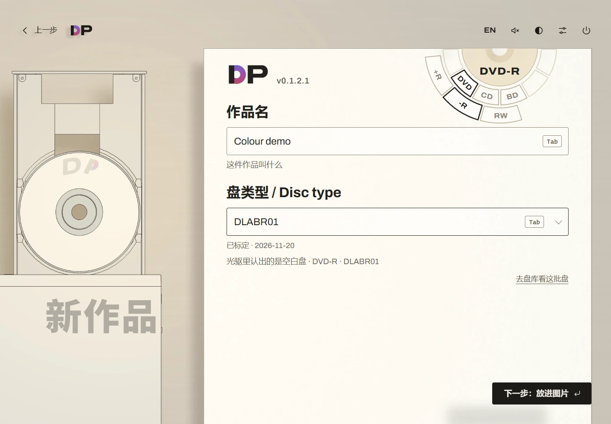
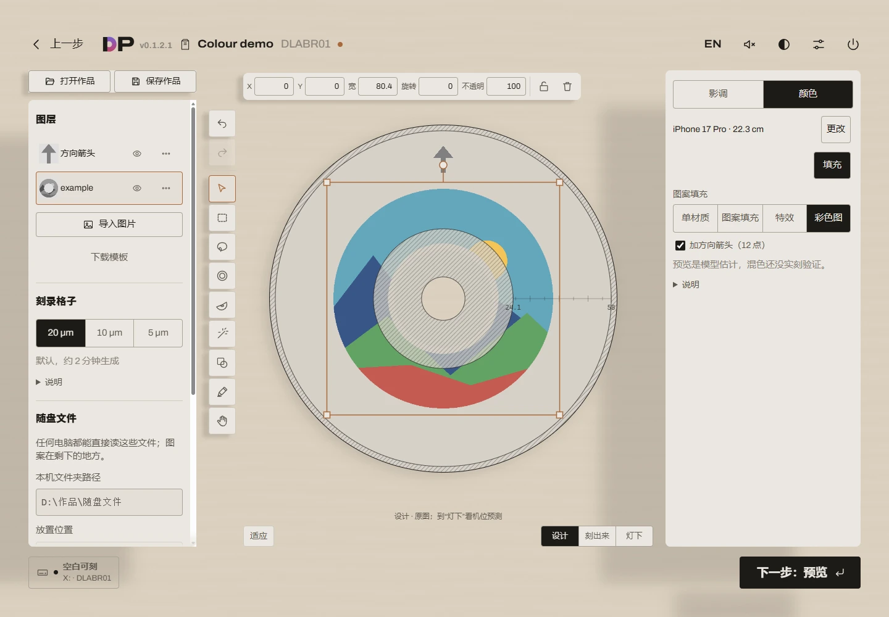
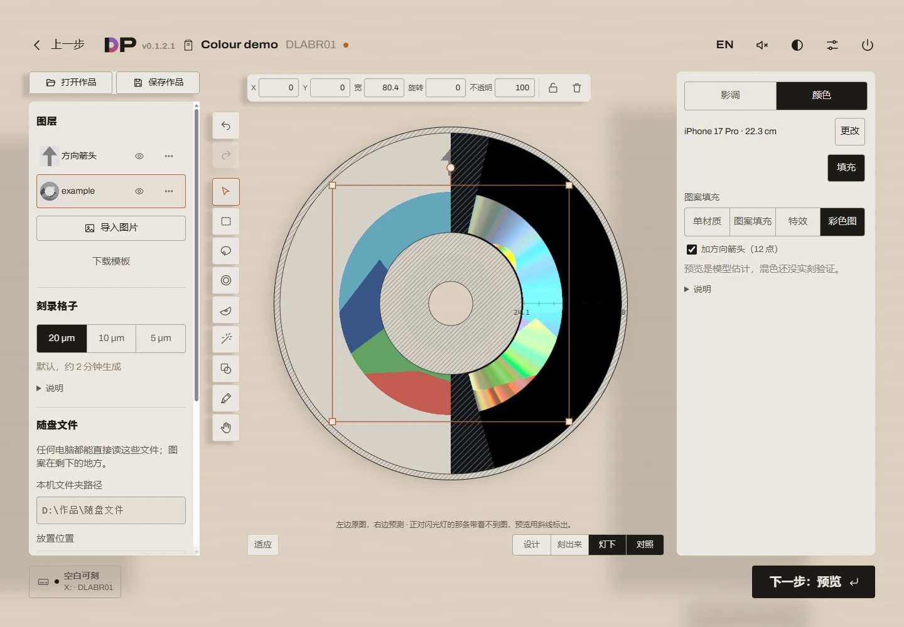
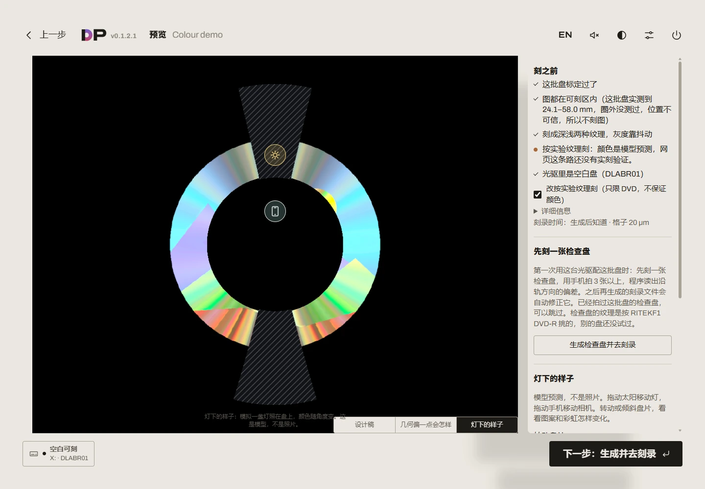
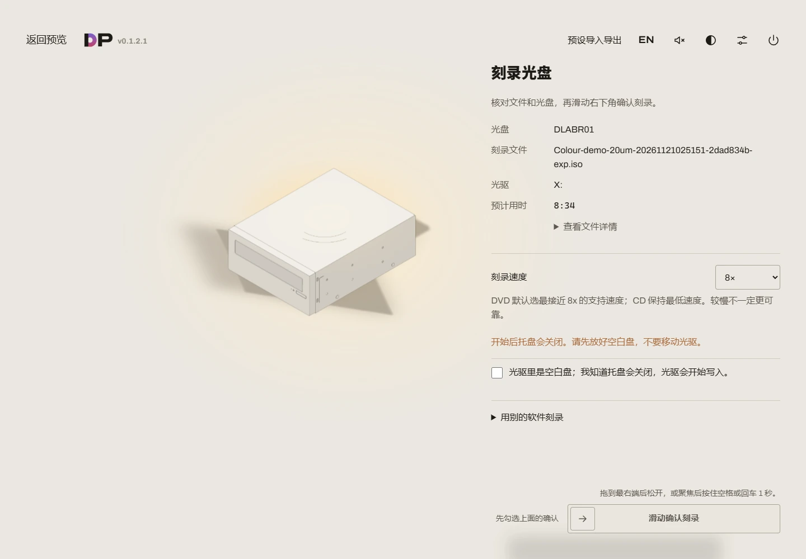
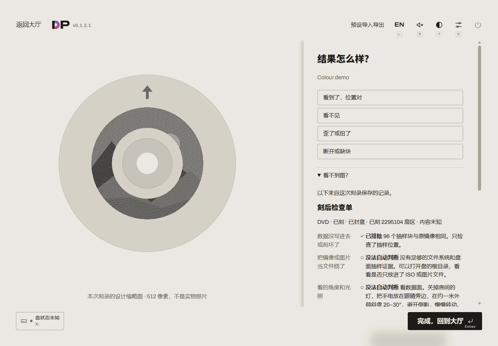

# 彩色 DVD 刻图

[English](colour.md) · [README](../README.md) · [刻图前为什么要标定？](why-calibrate.zh.md)

disc-probe 可以把照片或插画刻在 DVD 的数据面上。第一次可以选轮廓清楚、色块比较大的图。[下载示例 PNG](colour-guide/example.png)，网页和命令行都能用。

导出 Display P3、Adobe RGB 或 Rec.2020 图片时，保留内嵌的 ICC 配置文件。网页编辑器和 `colour-design` 会转换为 sRGB，并显示用到的配置文件。带 RGB 矩阵及色调曲线配置的 16 位 PNG 会保留原精度到转换完成。配置文件读不了或不受支持时，会提示并按 sRGB 读取。没有内嵌配置的图片也按 sRGB 读取。

## 实盘是什么样

沿轨道反复写入同一段位序列，这块盘面就像一块**衍射光栅**，把白光里的不同波长送往不同方向。重复间距不同，同一角度能看到的颜色也不同。disc-probe 根据六张色卡盘的实拍拟合出一张色表，从 58 种纹理里逐格挑选。即使是同一种颜色，盘上两处离闪光灯和镜头的角度不同，也可能要用不同的纹理。

**设计机位**就是挑纹理时用的拍摄布置，包括主摄的位置和高度、闪光灯的位置，以及盘的朝向。手机挪一点或盘转一点，颜色就可能变淡、变色，或者整条色带换个地方。想拍出能复现的颜色，用支架固定手机。拿在手里可以慢慢倾斜找图，颜色会跟着角度走。

 

这两张是彩色测试盘的实拍。几种颜色能同时看到，有些块很暗，亮反光也会盖住一部分。实盘通常比预测暗，饱和度也低一些，有时会看到放射状的色带或反光。小字、平滑渐变和肤色比较难还原。实盘颜色目前只在 **RITEKF1 DVD-R 搭配 GH70N** 上验证过。其他盘（包括可擦写 RW）和其他刻录机的彩色效果都未验证。网页导出的彩图和 `vivid` 映射仍待实刻对照。

## 在网页里做

截图用的是纸色主题和 Disc Lab 虚拟光驱。实际刻录时，准备同一台光驱测过的那一批空白 DVD-R。按 README 的方法[打开网页](../README.md#网页)。

1. 在大厅选 **新作品**。

   

2. 填作品名，选 **DVD-R** 和盘的批次，再进设计页。批次可以稍后再定，先摆图。生成刻录文件前，预览会请你选批次或标定。

   

3. 点 **导入图片**，选中图片图层，再选 **颜色 → 彩色图**。选手机和拍摄高度，点 **填充**。保留 **加方向箭头（12 点）** 的勾选。在 **设计** 视图里确认箭头看得见，重要内容避开盘心。在左栏的 **刻录格子** 可以换格子大小。

   

4. 打开 **灯下**，再点 **对照**。左边是原图，右边是预测。斜线标出这个机位下模型无法显色的区域。如果重要内容落在那条带里，移开图案或改拍摄高度，再点一次 **填充**。

   

5. 点 **下一步：预览**，在 **刻之前** 核对批次和实测范围。可见图层中有彩色图时，默认勾选 **改按实验纹理刻**，要刻彩色就保留勾选。没有标定的批次按提示测完再回到作品。页面另有 **先刻一张检查盘**，用专用检查盘的照片修正图案沿轨道方向的位置。确认后点 **下一步：生成并去刻录**，生成作品的 ISO 并进入刻录页。

   

6. 在刻录页核对刻录机、空白盘和速度。DVD 默认选光驱支持且最接近 **8×** 的速度，先用这个速度。勾选确认框，再用右下角的 **滑动确认刻录**。DVD-R 写入后无法撤销。

   

7. 刻完点 **下一步：结果怎么样？**，查看抽样回读。把盘的数据面朝上，按下节的方法对齐箭头，用手机 **1× 主摄** 开闪光拍一张，再记录实际看到的效果。结果页显示的是保存的设计缩略图。

   

## 摆手机和闪光灯

把盘平放在暗色表面上，数据面朝上，尽量避开室内灯光和亮反光。盘上箭头对准[放盘指示器](../tools/make_rulers.py)的 12 点。主摄镜头在十字正上方，即盘心向 12 点偏 **28.45 mm**。手机保持与盘面平行。转动手机，让闪光灯沿同一条线比镜头更靠近 12 点方向。iPhone 17 Pro 的闪光灯在离盘心约 76.4 mm 的位置，其他手机用自己的镜头到闪光灯距离在纸上标点。

用设计时选的高度，量的是**桌面到镜头**，并把闪光灯设为**开**。本指南从 **22.3 cm** 开始。iPhone 17 Pro 可以用放盘指示器上给参考取景用的 4:3 照片九宫格。按原尺寸（100%）打印，用纸上的比例尺核对尺寸。换高度或换手机时，用实测的镜头与闪光灯位置和尺子定高。有支架就每次只调一点，比如升高手机或转盘，再回到设计机位。只能手持时，也对着同样的标记，在设计机位附近多拍几张。

| 手机 | 1× 镜头到闪光灯 | 设置 |
| --- | ---: | --- |
| iPhone 17 Pro | **47.9 mm** | `iphone17pro` 预设。[苹果尺寸图，详图 D](https://developer.apple.com/download/files/accessories/dimensional-drawings/iphone-17-pro.pdf#page=2) |
| iPhone 17 Pro Max | **53.6 mm** | 自定义，54 mm。[苹果尺寸图，详图 D](https://developer.apple.com/download/files/accessories/dimensional-drawings/iphone-17-pro-max.pdf#page=2) |
| iPhone 17 | **19.0 mm** | 自定义，19 mm。[苹果尺寸图，详图 D](https://developer.apple.com/download/files/accessories/dimensional-drawings/iphone-17.pdf#page=2) |

距离用图纸上的横、纵偏移算出。17 Pro 的两项是 43.66 mm 和 19.79 mm。后两款给的是图纸尺寸，彩色拍摄效果未测。

量别的手机时，先在光线好的地方打开后置相机的 1×，用手短暂遮住各个候选镜头，看取景画面来辨认主摄。用透明尺直接量机背上从镜头中心到闪光灯中心的直线距离，也可以放一把同平面的尺子，从正上方拍照量。四舍五入到毫米，选 **自定义**（10–60 mm）。摆手机时仍让镜头和闪光灯中心沿着 12 点方向排成一线，必要时转动手机。

<details>
<summary>生成可打印的放盘指示器</summary>

安装 Matplotlib 后，在源码目录运行 `python tools/make_rulers.py --out rulers`。`--out` 指定输出目录，脚本默认是 `D:/dp-dev/tmp/focal`。生成的 `rulers/dp_rulers_1x_new_letter.pdf` 第 1 页是高度尺，第 2 页是照片放盘页。放盘页还印着旧的 21 cm，本例按第 1 页的 22.3 cm。盘的轮廓和瞄准十字通用，九宫格和闪光灯点按参考取景和距离画的。

</details>

## 在命令行里做

准备一个空的工作目录，确保在里面能运行 `python -m discprobe colour-design --help` 和 `python -m discprobe burn --help`。把[示例图](colour-guide/example.png)存为 `example.png`，也可以换成自己的图片。

### 1. 测这批盘

已经用这台光驱测过这批盘，并且结果可用，就记下那次的路径，直接去第 2 步。几何测量给出扇区在盘上的位置。可以用 `python -m discprobe results geo` 查已有结果。没测过，就取一张空白盘做测量盘，另留同批的一张空白盘刻图。将 `X:` 换成你的光驱，例如 Windows 的 `H:` 或 Linux 的 `/dev/sr0`。

```sh
python -m discprobe info --drive X:
python -m discprobe random --output random.iso --sectors 2295104
python -m discprobe burn --drive X: --iso random.iso --yes-write
python -m discprobe timing --drive X:
python -m discprobe geo --drive X: --ranges 0-2295088
```

- `--drive` 选光驱。读盘命令在终端里只有一台光驱时可以省略。刻录必须给 `--drive` 和 `--iso` 镜像路径。`--yes-write` 表示确认写入，每次运行前都要核对光驱和空白盘。
- `random --sectors` 是准备写多少扇区。DVD 默认 2,295,104 扇区（4.70 GB）。如果 `info` 给的可写容量更小，用它的数。`--output` 是镜像路径，默认 `iso/random.iso`。
- `timing` 检查读取时转得稳不稳，结果要看是不是 CAV，也就是恒定角速度。`geo --ranges` 选要读取的扇区区间。示例接近全盘，终点在镜像末尾之前的 16 扇区边界。如果刻了较小的 ISO，就换成这张盘上最后一个对齐的扇区。DVD 默认读已写区域的 3–85%。边缘能稳定读时，可以加宽范围，让图案往边上放。边缘总是读错就缩小测量范围，并把图放小。DVD 测几何时默认请求 4× **读速**。看结果里的实测区间，按提示处理读速或网格验证的警告，再用这次结果刻图。[测量手册](MANUAL.md)

### 2. 先看预测

```sh
python -m discprobe colour-design example.png --phone iphone17pro --height 22.3 --fit disc -o work.json --preview preview.png
```

生成镜像前打开 `preview.png`。按实际上能固定或拿稳的高度选机位，核对画面和方向箭头。预览给出这个机位的颜色预测。换机位会改变颜色，选好新机位后重跑这一条。

| 参数 | 默认值和什么时候改 |
| --- | --- |
| `example.png` | 必填的输入图片。第一次可用反差清楚的 PNG 或 JPEG。PNG 的透明区域可以避开盘心或没测到的半径，示例就是这样做的。 |
| `--phone`、`--height` | 两项必填。`iphone17pro` 用预设的闪光灯距离。`--height` 是桌面到镜头的厘米数，示例选 22.3 cm。拉远会改变盘面哪些地方能显色，也会让盘在照片里变小。 |
| `--flash-mm` | 用手机预设时可省略。用 `--phone custom` 时必填，按中心到中心的距离输入，程序取整后接受 10–60 mm。 |
| `--fit` | `disc`（默认）铺满盘面，会在盘心或外沿裁掉一部分。`ring` 把整张图放到盘心上方，占用的面积较小。两种摆法都按 DVD 的标称范围，生成前要看实测覆盖。 |
| `-o` / `--out`、`--preview` | 作品 JSON 路径必填。可选的 PNG 路径写出 600 × 600 预测图。省略可少等一会儿。第一次做或改完设计后最好保留。 |
| `--mapping` | `perceptual`（默认）用拟合色表在色相、饱和度和局部反差间取舍。想让颜色更醒目可试 `vivid`，以预测图为准挑选。它偏向更亮的纹理，浅色或暗色可能偏一些，明暗层次也可能变弱。它需要拟合色表，增益仍是模型预测。 |
| `--dither` | `ordered`（默认）用重复的 8 × 8 方格把相近候选纹理混排。`nearest` 每格只取一种匹配纹理，能减弱可见的网格花纹，代价是过渡可能更生硬。 |
| `--no-arrow` | 默认关闭，所以会加 12 点的随机数据对准箭头，通常沿半径 43.5–52.8 mm。要拍照或录像就保留，在 **设计** 或 **刻出来** 核对。 |

<details>
<summary>怎么选纹理库和自定义色表</summary>

第一次刻用随包的 58 种候选和拟合色表。可选纹理库是额外重复纹理的只读目录。`--texlib` 未指定时读取已设置的 `DISCPROBE_TEXLIB`。要查本机的纹理库，可以先看 `python -m discprobe textures --texlib /path/to/library find --help`。大纹理库里也有只预测过的纹理。尽量选为你的盘面和灯光条件做过的纹理，有实测颜色的优先。

要更换自动挑色的候选，用 `colour-design --materials candidates.json --table colour-table.npz`。JSON 选候选纹理规格，NPZ 提供它们随角度变化的颜色。默认用随包文件，`DISCPROBE_COLOUR_MATERIALS` 和 `DISCPROBE_COLOUR_TABLE` 可以覆盖。给 `compose` 传同一个 `--table`，保留作品保存的纹理顺序。若生成的纹理规格需要查库，给 `image --texlib` 传同一份库。换了候选或色表之后，可能超出已校准的颜色，先重新看预测。[随包的材质集](../discprobe/colour_print/materials.json)可用来查 JSON 格式。

</details>

### 3. 把作品变成通过检查的 ISO

把最后一个参数换成这次的 `geo` 结果目录或 `summary.json` 路径。下面的 Python 命令在 PowerShell 和 POSIX shell 都能用。它从网格旁的清单读取纹理顺序，把每项规格作为单独的参数传入。

```sh
python -m discprobe compose work.json --out design.npy
python -c "import json, subprocess, sys; from pathlib import Path; specs = json.loads(Path('design.textures.json').read_text(encoding='utf-8'))['textures']; subprocess.run([sys.executable, '-m', 'discprobe', 'image', '--geo', sys.argv[1], '--design-npy', 'design.npy', '--textures', *specs, '--r-max', '58', '--output', 'colour.iso'], check=True)" "results/geo-X-YYYYMMDD-HHMMSS/summary.json"
```

- `compose` 必须给作品 JSON 和 `--out` 网格路径。每格的材质编号写在 `design.npy`，对应的纹理顺序写在 `design.textures.json`，两份文件一起保留。
- `image --geo` 必填。传明确的结果路径，避免 `latest` 选到别的批次。`--design-npy` 是材质网格，`--textures` 为每个材质编号提供一个纹理。图案超出实测区间时，可以用同一张测量盘补测能稳定读取的半径，也可以缩小布局再看预测。网页设计页可以按所选批次的实测环带裁图。
- `--r-max` 是用来计算 ISO 长度的外半径，DVD 的 `image` 默认 **56 mm**。示例设为 58 mm，能用到量过的标称环带。半径变大可能让 ISO 变大，最多到写入器规定的 DVD 上限。如果镜像超过空白盘可写容量，降低半径，留意外圈图案可能被裁掉，再核对新镜像的扇区数。
- `--output` 指定 ISO 路径，`image` 默认用 `iso/grid.iso`。核对 `colour.iso.verification.json` 的状态是 `passed`，大小和修改时间与当前 ISO 相符。这是生成时把镜像与设计做的抽样核对。

<details>
<summary>刻录格子选 20、10 还是 5 µm</summary>

格子是能单独挑纹理的最小方块。格子缩小，边缘能更细，原图足够清楚时也能保留更多细节。显色还是要靠一片区域内反复写入的纹理。表中是设计页根据基准测试给出的整盘 DVD 合成和生成镜像的估计值，已取整，不含预览和实际写盘。机器忙或硬盘慢时，生成可能花上几倍时间。

| 格子 | 120 mm 盘面网格 | 大致耗时 | 预留峰值内存 | 怎么选 |
| --- | ---: | ---: | ---: | --- |
| 20 µm（默认） | 6,000 × 6,000 | 约 2 分钟 | 约 1 GB | 大色块、第一次刻图先用它。 |
| 10 µm | 12,000 × 12,000 | 约 4 分钟 | 约 2 GB | 原图有细节时，边缘和小图形更细。 |
| 5 µm | 24,000 × 24,000 | 约 10 分钟 | 约 5 GB | 边缘最细、耗时和内存开销最大，单独一格看不出颜色。 |

在设计页选格子再保存作品。命令行生成的作品可以在 `compose` 前改 JSON 顶层的 `cell`，用毫米填写 `0.02`、`0.01` 或 `0.005`。`colour-design` 生成的是 20 µm 作品，没有单独的格子参数。`image` 会根据数组尺寸认出格子。如果同时写 `--cell-um 20`、`10` 或 `5`，必须与数组一致，不会替你重采样。对比网格时沿用相同的几何和纹理。

</details>

### 4. 把图刻到盘上

换入同一批新的空白 DVD-R。用 `info` 确认盘是空的、下一可写地址是零，而且可写扇区够用，再确认写入。

```sh
python -m discprobe info --drive X:
python -m discprobe burn --drive X: --iso colour.iso --yes-write
```

`--speed` 用 1× 的倍数指定写速。DVD 省略时，选光驱支持且最接近 8× 的速度，先用这个值。用 GH70N 以 4× 刻过一张 RITEKF1 纹理测试盘，外圈读不出来。写入或回读不顺利时，先看刻录报告的失败位置和光驱对这张盘支持的速度，再决定要不要换速度重试。保留默认的回读检查，留意一致、不同、不可读和未检查的块数。抽样通过说明这些位置的数据一致。图案显色用上面的手机布置来核对。

## 常见问题

- **颜色偏了。** 先核对 12 点箭头、1× 镜头、闪光灯方向和镜头高度。把盘放平，减弱室内光。如果稍微一动颜色就变，先固定手机和盘，再改设计。
- **只看得到一种颜色。** 确认勾选了实验纹理。在设计机位附近慢慢挪动，看看哪些位置露出更多色块，然后回到标记位置。主体如果落在 **灯下** 预览的斜线带，往旁边挪再填充。
- **预览和实盘不一样。** 在相同机位下对照 **灯下**。模型算的是所选纹理的衍射光，可能比实盘亮。灯光、盘面和相机曝光还会改变观感。如果边缘拧了或图案缺带，也可能是几何或写入问题，先核对实测覆盖和抽样回读。
- **换了盘或光驱。** 即使盘的媒体码相同，也要用新批次的空白盘重新测量。先用几个大色块检查拍照和回读，再做整张作品。随包的颜色在其他 DVD-R 或 RW 上可能偏。

<details>
<summary>附录：给 agent 的检查清单</summary>

核对安装版 CLI 帮助、光驱与批次、实测覆盖、手机与高度、纹理来源和可见的 12 点箭头。出 ISO 前让用户确认模型预测，生成后核对当前镜像的校验记录。实际写盘前，另行取得对这份 ISO、这台光驱和这张空白盘的明确同意，刻后报告抽样回读的块数。[彩图技能](../skills/disc-colour/SKILL.md)

</details>
