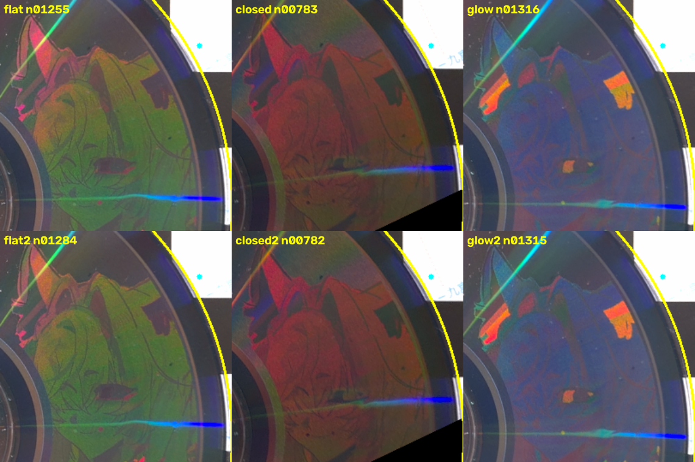
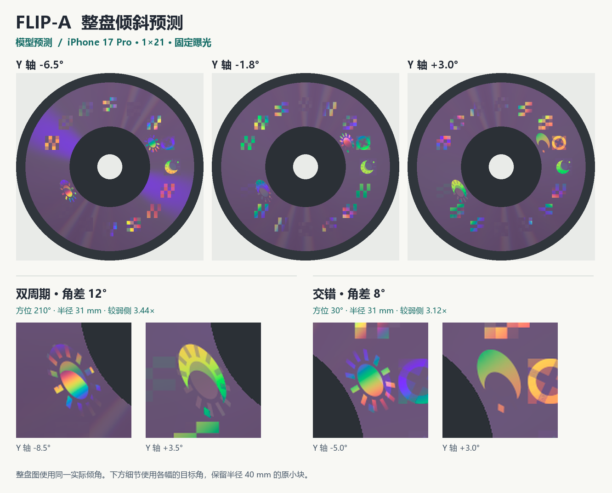

# Make a tilting grating card

On a DVD grating card, the same part of the disc shows different pictures as you tilt it. Repeated written marks form a diffraction grating. Each texture sends different wavelengths toward your eye at different angles. By mixing textures in small cells, the card gives each picture its strongest chance at its chosen angle.

[中文](grating-card.zh.md)

## Make a card from your pictures

Use a DVD geometry measured for your blanks. The command ships with 124 eligible textures used on the two recorded role cards. The index and channel report must both admit a texture. The command excludes textures containing byte `92` and requires the original limits of F512 below 1.5%, worst eight-sector frame lean at most 0.15, and absolute frame-end DSV of at most 100. These are recording-signal model checks.

```sh
disc-probe gratingcard sun.png moon.png --angles -6.5 3 --axis y --geo results/geo-run/summary.json --output iso/my-card.iso
```

Pass two or three images and the same number of distinct angles from −15° to +15°. Image order determines angle order. PNG transparency leaves room for the common background. The default box is 24 mm wide and centred at `(39, 0)` mm. Looking at the data side, x points to 3 o’clock and y to 12 o’clock. Change the box with `--centre X Y` and `--width MM`. The command writes the ISO, a material preview, a 20 µm label array with its texture list and a Markdown viewing guide. Use `--json` for their paths and the angle list.

Keep the camera and flash at the positions shown in the viewing guide. You can set a different measured rig with `--camera X Y Z --flash X Y Z`; z is height above the data surface. The 12 o’clock arrow marks the orientation on new cards. Positive X tilt raises 12 o’clock. Positive Y tilt lowers 3 o’clock. Turn off the room lights, use the phone flash or a single small light, and look at the disc near each angle before moving to the next.

<details>
<summary>What the solver and the archive replay do</summary>

The solver rotates the camera and flash coordinates into each tilted disc plane. It uses the table’s calibrated δ scale and models how illumination changes with distance. It fits area shares in linear colour across the target poses and nearby angles, then distributes those shares on the 20 µm grid with ordered dithering. Two views can overlap or change colour in the transition. Three views share the available light among more targets.

`--replay` rebuilds either a saved 0.06 mm weight grid or a version 2 DVD editor work on the 20 µm grid, using its material order and the same image writer. Supply the archived angles and use `--titles` to name the states. This preserves historical layout, marks and texture choices. Replaying the historical files is separate from computing a new layout from PNGs.

Use `--lookup` to supply a different role-card NPZ, along with its original `--channel-checks` file. The command loads `angle-curves-index.csv` beside the NPZ unless you give `--index`. The 58-texture colour-picture table uses a different format. Replays also need their own original channel report. The bundled subset keeps 124 of the 132 textures used across both cards. The other eight were tested in the FLIP-A comparisons and are available for historical replay with their archive reports.

</details>

## What the two recorded cards show

### SHOWCASE-BLINK 4-20

The character sits on the 3 o’clock side. Keep the 1× camera and light at the placement-sheet position. The archive’s camera was about 222 mm above the data face and 28 mm toward 12 o’clock.

| X tilt | Visible effect |
| --- | --- |
| 0° | The eyes are open. In the recorded footage the pupil appears purple and the face green-yellow. |
| +6° | The eye closes into a dark lash. Raise the 12 o’clock edge rather than sliding the phone so the character stays in frame. |
| −2.5° | The body turns dark blue-purple. The eyes and ear tips glow orange-red in the footage. |
| Between positions | A band of colour shifts along the scarf and hair tie. |



Real frames from IMG_8338, rectified to the disc. The physical card used 112 textures. The model predicted a larger brightness change at the eye than the phone recorded. Source record in the [colour-solver audit](goals/colour-solver-audit.md#4-已有实拍逐区对照).

### FLIP-A 4-21

Two large sun-and-moon motifs sit on opposite sides of the inner ring. In the design model both show the sun near **−6.5°** about the Y axis and the moon near **+3°**. One motif uses a texture with two periods in overlapping strokes. The other interleaves the two pictures across fine cells. The small outer panels compare angle spacings of 5°, 8° and 12°, plus the earlier O/X and a low-contrast control.



Model prediction. FLIP-A was recorded and passed 96 sampled readbacks. The photo evidence available for this card does not establish the two target angles. See the [LG delivery report](../CARD_REPORT.md#段-2--光栅角色卡).
