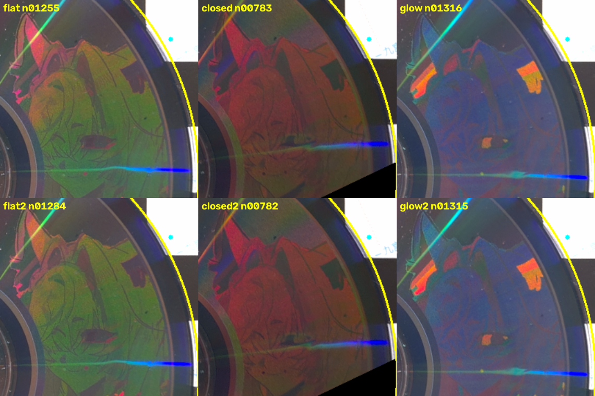
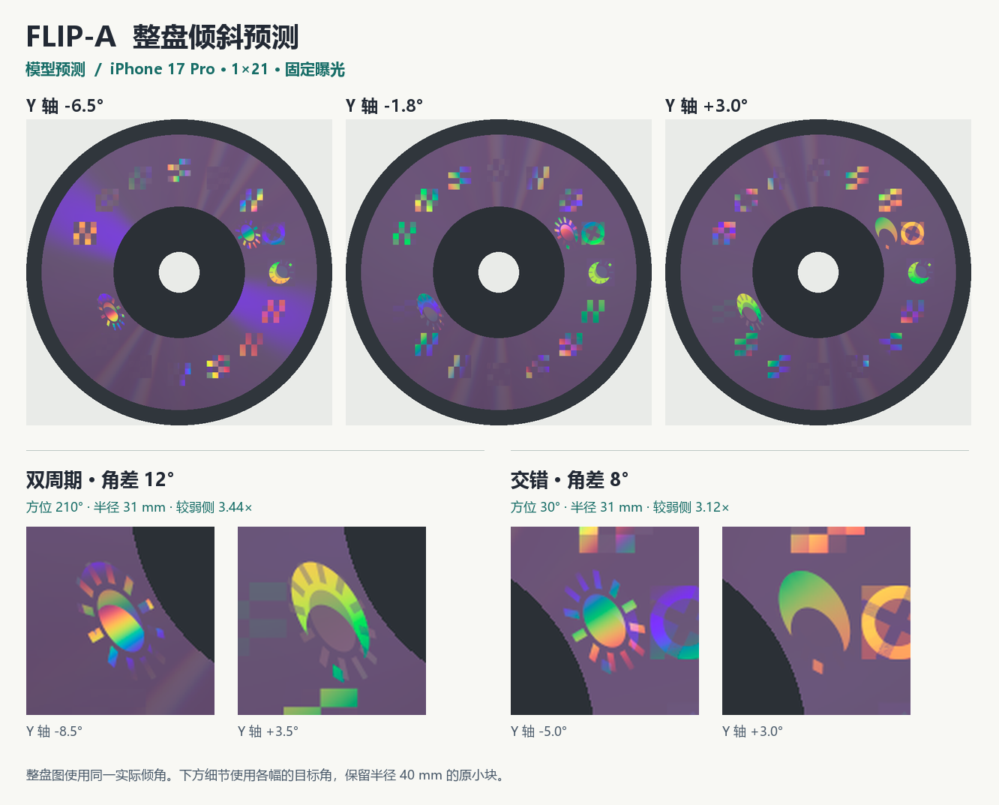

# 刻一张会换画面的光栅卡

光栅角色卡是一张随盘面倾斜切换画面的 DVD。同一小块里的刻录痕迹不断重复，形成衍射光栅。换个角度，纹理送进眼睛的光颜色就会变。把几种纹理分到小格里，可以让不同画面在各自的角度更容易看出来。

[English](grating-card.md)

## 用自己的图做一张

先准备同批 DVD 空盘的实测几何。命令随包带了两张实刻角色卡用过的 124 种合格纹理。纹理要同时在索引中合格并通过通道检查，并且不能包含字节 `92`。检查沿用原门槛：F512 低于 1.5%，最差八扇区平均帧偏不超过 0.15，帧末 DSV 绝对值不超过 100。这些检查量的是写入信号模型。

```sh
disc-probe gratingcard sun.png moon.png --angles -6.5 3 --axis y --geo results/geo-run/summary.json --output iso/my-card.iso
```

给两到三幅图，并按图的顺序给出同样数量的目标角度。角度在 −15° 至 +15° 内，彼此不同。用透明 PNG 可以留出共同背景。默认画框宽 24 mm，中心为 `(39, 0)` mm。从数据面看，x 朝 3 点，y 朝 12 点。可用 `--centre X Y` 及 `--width MM` 改摆放。命令输出 ISO、材质预览、20 µm 标签与材质序表，并写一份观看说明。加 `--json` 可读取输出路径和角度列表。

看卡时固定镜头和灯的位置，先找新盘上的 12 点箭头。要用另一台手机的实测机位，可加 `--camera X Y Z --flash X Y Z`，其中 z 是离数据面的高度。绕 X 轴正向转，抬高 12 点，绕 Y 轴正向转，压低 3 点。关掉屋里的灯，只开手机闪光灯或一个小光源，先在每个设计角度附近慢慢找，再往另一个角度转。

<details>
<summary>求解和存档复刻分别做了什么</summary>

求解时将镜头和灯的位置变换到每个倾角的数据面坐标。用查表的 δ 倍数计算纹理响应，也考虑灯距改变时的亮度。程序同时拟合目标角和旁边几个角度的线性颜色，再在 20 µm 网格上用有序抖动分配纹理面积。两幅画在过渡时可能串影或变色。三幅画要分用同一片盘面的光。

已有设计可用 `--replay` 重建。输入原先 0.06 mm 的面积权重，或使用 20 µm 网格的 DVD 编辑器作品。给出原角度，用 `--titles` 为每态命名。这个入口保留历史版式、标记和选材。从原始 PNG 重新求解会得到新的设计。

用 `--lookup` 可以换成其他角色卡响应表，同时给出原 `--channel-checks`。索引默认取表旁边的 `angle-curves-index.csv`，可用 `--index` 覆盖。彩色图片的 58 种纹理表格式不同。重建存档也要指定其原通道报告。两张实刻卡合计用了 132 种纹理，包里收录其中满足快照索引条件的 124 种。其余 8 种是 FLIP-A 的对照项，可随原档案复刻。

</details>

## 两张已有实刻盘

### SHOWCASE-BLINK 4-20

角色在 3 点方向。使用摆放纸固定手机和灯。档案中的 1× 镜头在数据面上方约 222 mm，朝 12 点偏 28 mm。

| 绕 X 轴倾角 | 能看到什么 |
| --- | --- |
| 0° | 眼睛睁开。实拍中瞳孔偏紫，脸偏绿黄。 |
| +6° | 闭眼，能看到一条深色睫毛线。抬高盘的 12 点侧更易把角色保留在画面内。 |
| −2.5° | 身体暗成蓝紫色。实拍里眼睛和耳尖亮出橙红色。 |
| 两态之间 | 围巾和发绳上的色带会随着倾斜移动。 |



图为 IMG_8338 的实拍帧，已拉正盘面。实刻盘使用 112 种纹理。眼部靠色相切换看出眨眼，实拍明暗差比模型预测小。参见[彩色求解器核查](goals/colour-solver-audit.md#4-已有实拍逐区对照)。

### FLIP-A 4-21

内圈相对两侧各有一幅太阳和月亮的大图。模型预测绕 Y 轴到 **−6.5°** 附近两幅同显太阳，转到 **+3°** 附近同显月亮。一幅把两个周期写进交叠笔画，另一幅用棋盘小格交错两张图。外圈小块对照 5°、8°、12° 三档角差，也保留了旧 O/X 和低反差对照。



图为模型预测。FLIP-A 已实刻，96 处抽样读回全相符。现有照片未核实表中的两个目标角。来源见 [LG 交付报告](cards/learn-grating-report.md#段-2--光栅角色卡)。
