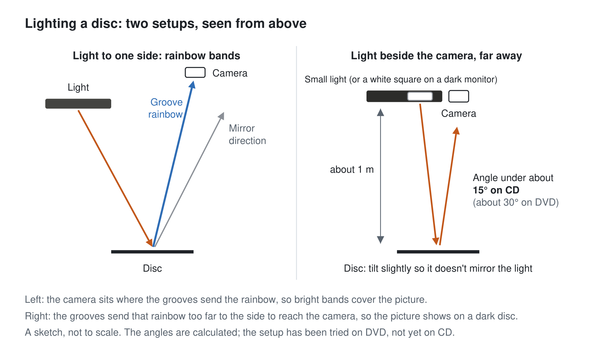
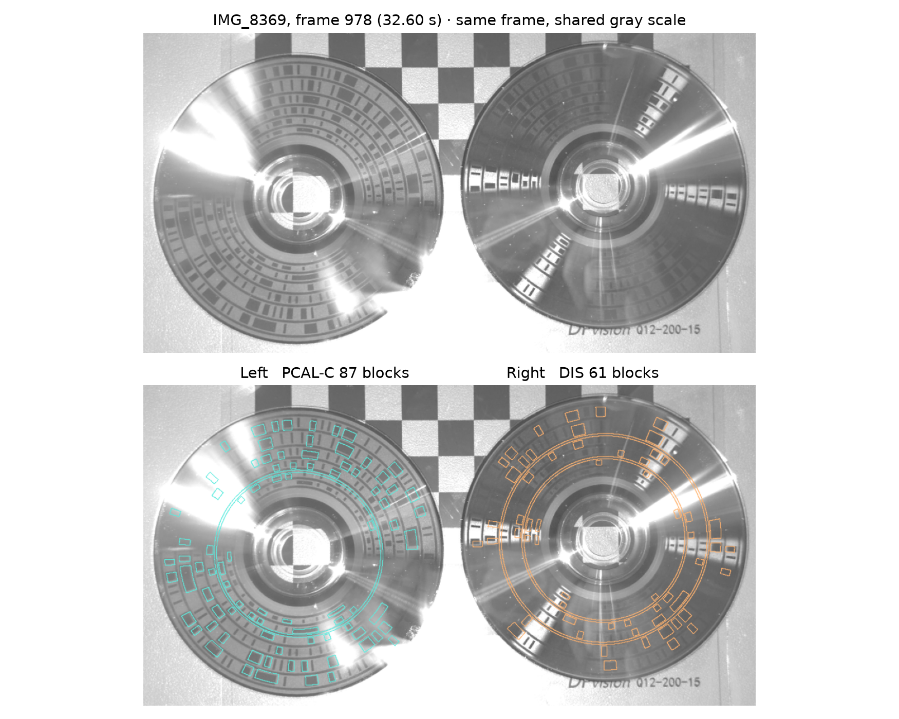

# How a disc becomes a picture

[中文](how-disc-images-work.zh.md) · [Why calibrate before burning a picture?](why-calibrate.md)

## Find the picture first

Face the data side toward you, turn off the room lights, and use one small light such as a phone torch. Start with its reflection on the disc. Tilt slowly until the reflection slips past the picture. Hold the light close to your eyes or the camera, and move a little farther away so the lighting angle varies less across the disc.

The disc acts like a mirror. It can reflect the lamp, bright walls, or the hand holding it. The grooves and the written data also send light in particular directions. This spreading of light by regularly spaced marks is called **diffraction**. An area looks bright when one of those beams reaches your eyes. Move the light, your eyes, or the disc, and the bright area moves.

<!-- start-guide-diagram -->



Lighting diagram. Try this setup first when looking at a finished disc.

## Turn two textures into light and dark

A **texture** is repeated data written across a small part of the disc. A black-and-white image usually uses two textures. One looks lighter and the other darker at the viewing angle. **Contrast** is the difference between their apparent brightness. Tilting the disc can reverse which of the two looks lighter.

**Dithering** makes grey by arranging light and dark textures in small cells. An area with more light cells looks lighter. The Brightness slider changes which cells a source image gets. If Brightness +45 looks much the same, compare the cells of a mid-grey area in As burned. Then change the lighting angle and see whether the two textures separate. Brightening the source cannot increase the physical contrast of the two textures.

<details>
<summary>Try brightness, contrast and dithering</summary>

Import three large patches of black, grey and white. Adjust brightness, then adjust contrast on its own. Watch how many light cells are in the middle patch and whether black and white lose detail. Then change the dithering method to see a different arrangement of cells. The lighting angle and phone image resizing can both affect how visible these cells are.

</details>

## Why a grating changes colour

A **grating** is a pattern of regularly repeated marks. The distance between repetitions is its **period**. Repeating data along the track gives you a choice of periods. Under white light, the wavelength sent toward the camera depends on the period, the positions of the light and camera, and where that patch is on the disc.

For the same angle, a longer period sends a longer wavelength into the camera. Tilting the disc or moving the phone changes the angle for that patch, and the colour shifts. For colour pictures, use the placement sheet to set the phone, lens height and flash direction. Take your first comparison photo at the design position.

<details>
<summary>Delta and wavelength</summary>

**Delta (δ)** is the absolute projection of the two unit directions from the cell to the light and camera, added together, along the tangent to the track. It has no unit. For first-order diffraction, wavelength is the grating period multiplied by delta. The factory grooves repeat across the radius and make their own rainbow. When two neighbouring patches suddenly show different colours, compare the textures written in them.

</details>

## See more of the picture with mixed textures

Mixing textures that brighten at different angles can make more of one photo usable. A single texture can still have stronger contrast at its best angle.

**Measured.** In three side-by-side videos of PCAL-C and DIS, the shared tilt groups were weighted equally across left and right placements. Counting patches where the brighter side was at least 1.15 times the darker, mixed-texture PCAL-C averaged about **87 visible patches** per frame, compared with **61** for the DIS textures. The photo below is one frame with those exact counts. See the PCAL comparison `REPORT_R2.md`, frame 978 from IMG_8369.



<details>
<summary>Local delta coverage and whole-disc tilt</summary>

**Measured.** At the 1.15 threshold, PCAL-C had a wider local delta range than DIS. With bins 0.03 wide, the median-contrast curves cleared the threshold over widths of 0.373 and 0.040. The ratio varied widely with bin width and which videos were included. DIS still showed strong local bands over a narrower range. Source `D:/dp-dev/tmp/video/pcalcmp/REPORT_R2.md`.

**Measured.** Scoring the whole discs by centre tilt in the same videos, the observed widths at 1.15 were about 2.5° and 3.4°. Source `D:/dp-dev/tmp/video/pcalcmp/REPORT.md`.

**Inference.** The mixed texture can give you more edges to line up in one photo and make the pattern detectable under a wider spread of local conditions. The size of the gain depends on placement, lighting and the measure you use.

</details>

## How the colour solver picks textures

For each cell, the solver calculates delta from the design pose and looks up the colour each candidate texture would produce. It maps the source colours to the lightness and chroma available there, then chooses nearby textures. Ordered dithering uses a repeating grid to blend several candidates. The solver also smooths choices across nearby angles to reduce fine radial streaks across a flat colour.

If the image is in the right place but the colours shift when you move the phone, check the phone model, placement sheet, lens height, flash position and the disc’s 12 o’clock direction. After changing the phone or height, choose the new pose and apply the colour fill again. If the batch changed, or parts of the image bend or land in the wrong place, check that batch’s measured geometry. Areas outside the colour table’s angle range may show no colour.

<details>
<summary>When to calibrate again</summary>

Disc geometry maps sectors to positions for a batch of blanks. The shooting pose gives the light and camera positions. If moving the phone shifts the colour, start by applying the fill for the new pose. If several discs from one batch consistently put the same lines in the wrong place, inspect the geometry or measure missing radii. If the geometry is right and colours are still consistently off at the design pose, keep the source image, unadjusted photo, batch and pose together for colour-table testing. See the [colour solver audit](goals/colour-solver-audit.md).

</details>

## Make a grating card that changes picture

Start with measured geometry for your blanks and two pictures with clear outlines, such as a sun and moon. The command creates an ISO and viewing guide. The two angles in the example are a starting point.

```text
disc-probe gratingcard sun.png moon.png --angles -6.5 3 --axis y --geo results/geo-run/summary.json --output iso/my-card.iso
```

Check the preview for the picture layout and the 12 o’clock alignment arrow, then burn the ISO as a disc image on a blank from the same batch. Fix the phone and light as described in the viewing guide and tilt slowly near each target angle. The [grating card reference](grating-card.md) shows where to look on the recorded cards, with a real photo of 4-20 and a labelled model prediction for FLIP-A.
