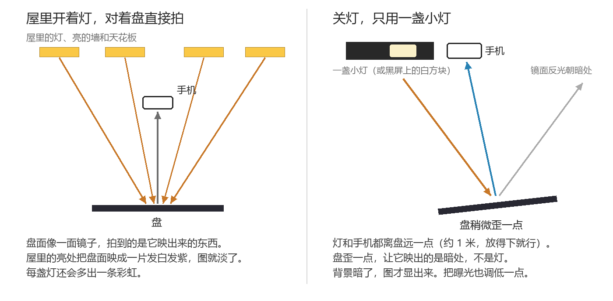
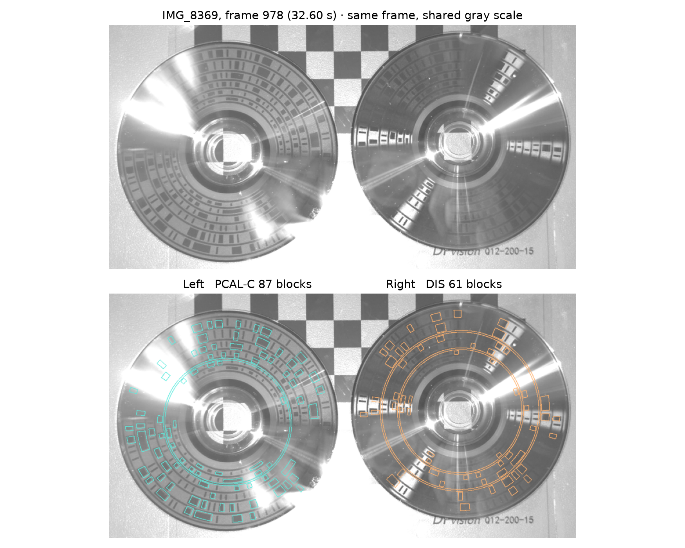

# 光盘怎么变成图

[English](how-disc-images-work.md)

## 先把盘上的图找出来

把数据面朝向你，关掉室内灯，用一个小光源，比如手机手电筒。先让光源的倒影出现在盘上，再慢慢倾斜，让倒影刚好滑出图案。把灯放在眼睛或镜头附近，稍退远一些，整张盘上的照明角度会更接近。

盘面像镜子，直接反射会把灯照得很亮，也会映出屋里的亮墙和你的手。盘上的导槽和刻过的数据还有另一种作用：间距规则的纹路把光分往几个方向，这叫**衍射**。当某一束光恰好进眼睛时，那一片就亮。移动灯、眼睛或盘，亮的地方就会移动。

<!-- start-guide-diagram -->



摆灯示意图。刻好的盘最好先按这个方法找一遍角度。

## 让两种纹理变成明暗

**纹理**是一小片盘面反复写入的数据。黑白图通常用两种纹理。它们在选定的角度一亮一暗。两种纹理在实体盘上的亮度差叫**对比度**。倾斜时两者的明暗可能互换，图案仍在。

灰色靠**抖动**做出来。把亮、暗两种纹理排进你看不清的小格，亮格多的地方看起来更亮。亮度滑块改变的是原图怎样分到这些格里。“亮度 +45”以后看起来差不多时，先在「刻出来」视图比较中灰的格子。接着换个光照角度，看两种纹理有没有拉开差距。提亮原图无法让两种实体纹理的反差变大。

<details>
<summary>怎么试亮度、对比度和抖动</summary>

用一张黑、灰、白三格图，先调亮度，再单独调对比度。看灰格里的亮格比例、黑和白是否还有层次，然后再换抖动方式。不同抖动会改变小格的排列。灯下角度和拍摄缩图也会改变你能不能看见这些小格。

</details>

## 光栅为什么会变色

**光栅**是按固定间距重复的细纹，这个间距叫**周期**。沿数据轨道重复某段数据，就能得到一种可选择的周期。白光照过去，能进镜头的一束光是什么颜色，由纹理周期、灯的位置、相机的位置以及这块纹理在盘上的位置一起决定。

同一个角度，较长的周期会把较长波长的光送进镜头。转盘或挪手机时，同一块纹理对着镜头的有效角度变了，颜色也就变了。做彩色图时，按摆放纸约定手机、镜头高度和闪光灯方向。想对照预测，先用设计机位拍一张。

<details>
<summary>δ 和波长</summary>

**δ** 是从小格分别指向灯和镜头的两个单位向量相加后，在该格轨道切线上的投影绝对值。它没有单位。对一阶衍射，进镜头的波长等于 δ 乘以纹理周期。盘出厂自带的导槽沿半径方向重复，也会产生自己的彩虹。邻近的两小块突然出现不同颜色时，可以比较它们写入的纹理。

</details>

## 混合纹理让更多地方看得清

混合几种有不同角度响应的纹理，能让一张照片里亮起更多可用的小块。一个代价是最好的角度未必还能像单一纹理那样反差很强。

**实测。** 对三段 PCAL-C 与 DIS 同框视频，在共同倾角组内对左右摆放等权。以亮的一方至少是暗方的 1.15 倍为门槛，混合纹理的 PCAL-C 一帧平均约 **87 块**可辨，DIS 纹理约 **61 块**。下图是一帧恰好得到 87 和 61 的同框实拍。来源是 PCAL 对比的 `REPORT_R2.md`，图为 IMG_8369 第 978 帧。



<details>
<summary>局部的 δ 范围和整盘倾角怎么比</summary>

**实测。** 在 1.15 倍门槛下，PCAL-C 的局部 δ 范围比 DIS 宽。用 0.03 宽度分箱，中位反差曲线的达标宽度为 0.373 和 0.040。改变分箱宽度或纳入的视频，具体倍数会大幅变化。DIS 在较窄范围内仍能出现强条带。来源为 `D:/dp-dev/tmp/video/pcalcmp/REPORT_R2.md`。

**实测。** 同一批视频按盘心倾角给整盘评分，则共同拍到的 1.15 倍对比达标宽度约为 2.5° 和 3.4°。来源为 `D:/dp-dev/tmp/video/pcalcmp/REPORT.md`。

**推断。** 混合纹理通常能给你更多可对齐的图案边缘，也更容易在不同局部角度看到图。能多宽须看你的摆放、灯和采用的评价尺度。

</details>

## 彩色求解器怎样挑纹理

求解器先照你的机位算每一小格的 δ，再查候选纹理在该 δ 下会给出什么颜色。它把原图颜色压进当地可能达到的亮度和色度，挑接近的纹理。有序抖动模式会用固定小格分布混合几个候选。相邻角度的选择也会平滑一些，让大片同色区域少出现细细的放射条纹。

如果图案位置对，整幅颜色却随着拍照角度明显变，先检查手机型号、摆放纸、镜头高度、灯的位置和盘的 12 点方向。换了拍摄高度或手机，重新选机位并填充。换了盘批次，或者各处图形弯曲、比例不对，回头核对这批盘的刻图几何。色表外的角度可能留下看不到彩色的区域。

<details>
<summary>什么时候该重测</summary>

几何标定给出每个扇区在这一批盘上的位置。机位标定给出灯和镜头的坐标。改了机位后整幅颜色偏移时，先重做颜色填充。如果固定机位、多张同批盘都在重复的位置错位，检查批次的实测几何或补测缺失的半径。如果线条位置准、色块在标定机位仍稳定偏色，保留原图、原照片、盘批次与机位，供色表验证。已测范围和局限见[彩色求解器核查](goals/colour-solver-audit.md)。

</details>

## 自己做一张会换画面的光栅卡

准备同批空盘的实测几何。找两张轮廓清楚的图，例如一个太阳和一个月亮。用下面的命令生成镜像和观看说明。命令里的两个倾角可作为第一张试验的起点。

```text
disc-probe gratingcard sun.png moon.png --angles -6.5 3 --axis y --geo results/geo-run/summary.json --output iso/my-card.iso
```

确认数据面预览里的 12 点对准箭头和图案摆放，再将 ISO 作为光盘镜像刻入同批空盘。照生成的观看说明固定手机与灯，在两个角度附近慢慢倾斜。用[光栅卡命令与实拍说明](grating-card.zh.md)核对哪块该亮、哪块该淡下去。4-20 已有实拍，太阳和月亮版示例图标明了模型预测。
