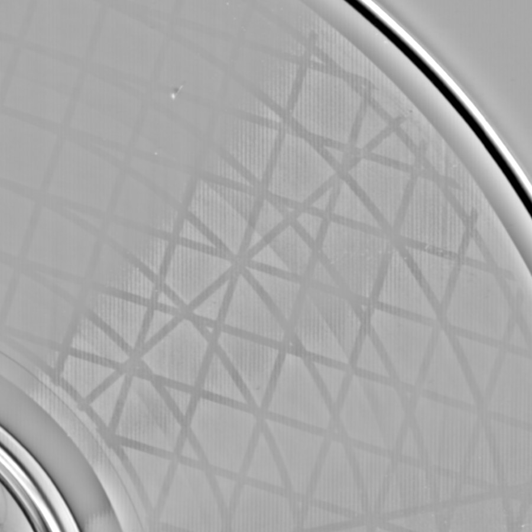

# Why calibrate before burning a picture?

[简体中文](why-calibrate.zh.md)

An optical drive writes along one long spiral, so disc-probe measures your drive and batch of discs to find the radius (distance from the centre) and angle (direction around the disc) where each piece of data will land.

## What happens if you skip it?

Imagine drawing a spoke from the middle of the disc out to the rim. Each turn of the spiral needs a mark in the same direction. If the software estimates the spacing between turns a little wrong, each mark moves a little farther from the last. Across tens of thousands of turns, a straight line can wind around the disc and the picture can smear into rings. That’s one explanation for “Circles it is,” a report from the DiscImageStudio community. [README on the spiral](../README.en.md#how-it-works) · [Troubleshooting notes](cards/nothing-shows.md)

The lines in this scan stayed straight on the DVD. The grid was made using the drive’s timing measurements. [README on the test grid](../README.en.md#geometric-accuracy)

## How to measure your discs

- Make a measurement disc. Start with a blank from the batch you’ll use for the picture. Write the `random` command’s ISO, a file that holds the data to burn to the disc, as a disc image. This fills the spiral with ordinary readable data, so the software can time reads from the inner and outer parts. A blank has nothing to read, and the data patterns used to make light and dark areas in pictures often cause read errors. The random data has no design arranged across the disc, so it looks like an ordinary data disc. If you already have a disc from the same batch with readable random data over the area you need, you can use it. [Manual on preparation](MANUAL.en.md#preparation)
- Check the rotation with `timing`. The drive rereads data to find how long the disc takes to turn and whether it spins steadily enough to measure.
- Measure the layout with `geo`. With steady rotation, the gap between read times tells the software how far around the disc the data sits. It starts with nearby pieces of data and works outward, keeping count of whole turns. A good measurement is usually enough to make a DVD picture.
- For a data CD, also measure the along-track constant. That’s the shift between the positions inferred from read times and where the written pattern sits along the spiral. Burn a target to photograph or use a grid disc and measure how much its straight lines twist. The measured shift belongs to that drive and way of writing the disc. [CD route](../README.en.md#cd-route) · [CD details in the manual](MANUAL.en.md#cd-r-textures-timing-and-burning-pictures)

For a first picture, the README gives a minimum of 2 discs for DVD (measurement and picture) or 3 for CD (measurement, calibration and picture). The web guide plans for 3, with a check disc before the finished picture. A large error can mean a second check and a 4th disc. A bad photo can be retaken on the same disc. [README disc budget](../README.en.md#quick-start)

The web guide budgets about 14 minutes to burn the DVD measurement disc. The README’s CD example took about 11 minutes on a GH70N at 8×. Once the measurement disc is ready, `timing` takes about 1 to 3 minutes and `geo` about 5. The web guide uses about an hour as a planning target for the first picture. Your drive, the picture and any extra checks will affect that. [Web guide estimates](../discprobe/web/home/guidance.mjs) · [DVD timings](../README.en.md#step-3-check-the-drive) · [CD example](../README.en.md#cd-route)

What if the first measurement is poor?

If `timing` finds that the drive changes speed, try the suggested read speed. Use that same speed for `geo`. A measurement only covers the part of the spiral you were able to read. Before designing over an unmeasured area, follow the measurement screen’s advice about changing the read speed, measuring again or using a smaller area. [Manual on the geometry measurement](MANUAL.en.md#measuring-geometry-from-timing-the-ladder-geo)

## When to measure again

Keep your measurement and reuse it for the same batch and drive. Measure again when you change batches or drives. The MID is the media identification code the drive reads from the disc. A different MID is an easy mismatch to spot, so the burn page stops for confirmation when it detects one. Batches can share an MID, so keep the blanks from the measured batch together. [README on limitations](../README.en.md#limitations) · [Post-burn checklist](CHECKBURN.md#no-picture-after-burning)

## The whole job on one page

Calibrate → Design → Burn → Look or photograph

The command column shows DVD examples. Start each command with `python -m discprobe`. [README command-line walkthrough](../README.en.md#quick-start)

| Step | Web app | Command line |
| --- | --- | --- |
| Calibrate | From **New work**, identify the batch and choose **Calibrate this batch**. Keep the measurement for that batch. | Read the blank with `info --drive E:`. Make the file with `random --output iso/random.iso` and write it with `burn --drive E: --iso iso/random.iso --yes-write`. Measure the recorded disc with `timing --drive E:` and `geo --drive E:`. |
| Design | In **Design**, import and place the picture. Use **Preview** to inspect it and make the image file. | `edit my_picture.png` to place it, then `image --geo results/YOUR-RUN/summary.json --design my_picture.design.json --output iso/picture.iso`. Use the saved design and measurement paths from your own run. |
| Burn | On **Burn**, check the blank and write the image. | `burn --drive E: --iso iso/picture.iso --yes-write` for DVD. Confirm the drive and blank before running it. |
| Look or photograph | On the post-burn page, record how it looks or open **Can’t see the picture?** to review the checks. When checking with photos, follow the prompts for a check disc or photos from the burn result. | Look at the data side under a small light near your eye or camera. If the picture is missing, run `checkburn --drive E: --iso iso/picture.iso`. |

Command-line routes for CD and photo checks

For a data CD, add `--media cd` to `random`, `timing` and `geo`. Use `disexport` to take the measured geometry into DiscImageStudio and run its fine calibration, or follow the manual’s grid-disc route before making the picture. On Windows, the built-in `burn` command doesn’t write CDs. See the [README’s CD route](../README.en.md#cd-route) for writing instructions. For a supported check target, `photo` reads the shift from photos, while `gridscan` measures crooked lines in a flatbed scan of a grid disc. [CD and photo checks in the manual](MANUAL.en.md#cd-r-textures-timing-and-burning-pictures)

## Common questions

### Can I use a nominal DiscImageStudio preset?

A preset is a saved set of disc dimensions and other settings. A nominal preset uses standard values as a starting point. For a finished picture, use settings measured for your own batch and drive. If you already burned with a nominal preset and see rings, check lighting and read-back before spending another blank. [Post-burn checklist](CHECKBURN.md#no-picture-after-burning)

### Why does the measurement disc look ordinary?

Its job is to give the drive data to read. The picture only goes on a later blank, after the software knows where to put the light and dark areas.

### Is calibration the same as taking a photo?

Calibration measures where the pattern lands. Read timing supplies most of that information. A photo of a known target can supply a missing shift or check how far the result moved. A photo of your finished picture can simply be for sharing. For colour, the phone and light positions also decide which colours you see. [How a disc becomes a picture](how-disc-images-work.md)
