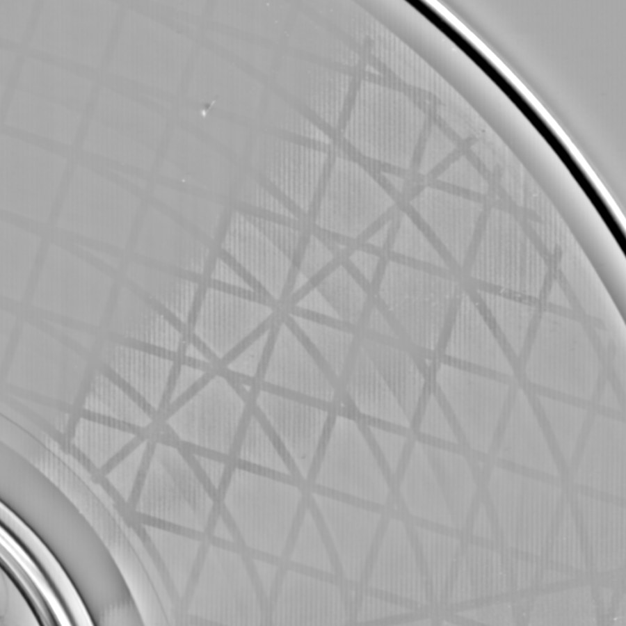

# 刻图前为什么要标定？

[English](why-calibrate.md)

光驱沿着一条很长的螺旋线写数据，每台光驱、每批盘都有一点差别，所以刻图前要先量出每段数据会落在哪个半径（离盘心多远）、哪个角度（朝哪个方向）。

## 不量会怎样？

想象从盘心往外画一条直线。螺旋每绕一圈，都要在同一个方向落笔。要是软件把相邻两圈的间距估错了一点，这一圈的落笔位置就比上一圈多偏一点。绕过几万圈，一条直线可能拧成漩涡，整幅图也可能沿圆周抹成一圈圈的环。DiscImageStudio 社区有人说「Circles it is」（还是一圈圈的），标定偏差就是其中一种可能。 [README 原理](../README.md#原理) · [排错走查](cards/nothing-shows.md)

这张 DVD 网格用光驱的计时测量结果生成。扫出来的网格线在盘上仍然是直的。 [README 几何精度](../README.md#几何精度)

## 怎么量？

- 先刻测量盘。从要刻图的那一批里拿张空盘，把 `random` 生成的 ISO 刻进去。ISO 是刻录机要写进盘里的镜像文件，要选「刻录光盘映像」。空白处没有数据可读，随机数据填满盘面后，光驱就能从内圈到外圈计时读盘。用来表现图案明暗的数据常会让光驱读不出来。随机数据没有按图案排列，所以这张盘看起来就像普通数据盘。手头已有同批的盘，只要要测的范围里有可读的随机数据，就可以用。 [手册里的准备步骤](MANUAL.md#准备)
- 用 `timing` 测转速。光驱反复读数据，量一圈要多久，看看盘转得够不够稳。
- 用 `geo` 测几何。几何就是数据在盘上的位置。转速稳时，读完两处数据的时间差就能换成角度差。软件从相隔很近的两段数据开始，往外逐段量，同时数清中间隔了几整圈。DVD 的测量结果可用时，一般就能刻图了。
- 数据 CD 还要定沿轨常数。把读盘计时推出来的位置和图案实际落点放在同一条螺旋线上看，两者相差的那一段就是沿轨常数。可以刻一张标靶拍照，也可以刻网格盘，看原本应该是直线的地方扭了多少。这项结果跟光驱和刻录方式有关。 [CD 路线](../README.md#cd-路线) · [手册里的 CD 细节](MANUAL.md#cd-r纹理计时与刻图)

第一次要准备几张？按 README，顺利的话 DVD 最少 2 张（测量盘、成品），CD 最少 3 张（测量盘、标定盘、成品）。网页按 3 张安排，中间留一张检查盘。偏差大时可能还要再查一次，第 4 张才是成品。照片没拍好，拿同一张盘重拍就行。 [README 快速开始](../README.md#快速开始)

网页引导给 DVD 测量盘的刻录时间约 14 分钟。README 里的 CD 测量盘是在 GH70N 上以 8 倍速刻的，约 11 分钟。测量盘刻好后，`timing` 约 1 到 3 分钟，`geo` 约 5 分钟。网页引导按第一次出图约一小时来安排，实际还要看光驱、做图花多久、中间要不要再检查。 [网页引导估时](../discprobe/web/home/guidance.mjs) · [DVD 测量用时](../README.md#第-3-步看这台光驱能不能用) · [CD 实例](../README.md#cd-路线)

第一次的测量结果不好怎么办？

`timing` 提示转速不稳时，试试它建议的读取速度，接下来的 `geo` 也用同一个速度。测量只覆盖实际读过的范围。如果图要画到没测过的地方，先看测量页的建议，换速度补测或缩小出图范围。 [手册里的几何测量](MANUAL.md#计时测几何梯子测量geo)

## 什么时候要重新量？

同一批盘、同一台光驱，保存测量结果，以后可以接着用。换批次或换光驱就重测。MID 是光驱从盘上读出的介质识别码。刻录页发现 MID 对不上会先拦住，等你确认。不同批次也可能共用一个 MID，空盘最好按测过的批次放在一起。 [README 局限](../README.md#局限) · [刻后检查单](CHECKBURN.md#刻完看不到图)

## 整个流程

标定 → 设计 → 刻录 → 看或拍

下表以 DVD 为例。命令行里的每条命令前加 `python -m discprobe`。 [README 命令行步骤](../README.md#快速开始)

| 步骤 | 网页里 | 命令行 |
| --- | --- | --- |
| 标定 | 在「新作品」确认盘的批次，点「标定这批」，把测量结果留给这批盘用。 | 用 `info --drive E:` 读空盘，`random --output iso/random.iso` 生成镜像，再用 `burn --drive E: --iso iso/random.iso --yes-write` 刻。刻完跑 `timing --drive E:` 和 `geo --drive E:`。 |
| 设计 | 在「设计」导入图片、摆放位置，到「预览」检查效果并生成镜像。 | 用 `edit my_picture.png` 摆图，再用 `image --geo results/YOUR-RUN/summary.json --design my_picture.design.json --output iso/picture.iso`。把测量和设计文件换成自己保存的路径。 |
| 刻录 | 在「刻录」检查光驱里的空盘，再刻入镜像。 | DVD 可用 `burn --drive E: --iso iso/picture.iso --yes-write`。运行前确认光驱和空盘。 |
| 看或拍 | 在刻完页记下效果，也可以展开「看不到图？」看检查单。需要照片测量时，按刻录结果页的提示准备检查盘或拍照。 | 把小灯放在眼睛或镜头旁边，倾斜着看数据面。看不到图时，用 `checkburn --drive E: --iso iso/picture.iso` 检查。 |

CD 和照片检查的命令行做法

数据 CD 的 `random`、`timing` 和 `geo` 都加 `--media cd`。可以用 `disexport` 把测得的几何交给 DiscImageStudio 做精细标定，也可以按手册的网格盘方法量完再做图。Windows 上内置的 `burn` 不能刻 CD，刻录方法见 [README 的 CD 路线](../README.md#cd-路线)。对支持的检查标靶，`photo` 从照片里量偏移，`gridscan` 则从网格盘的平板扫描图里量直线弯了多少。 [手册里的 CD 和检查方法](MANUAL.md#cd-r纹理计时与刻图)

## 常见误会

### DIS 的名义预设能直接用吗？

DIS 是 DiscImageStudio 的简称。预设是一组保存好的盘面尺寸和刻图参数，名义预设用的是标准值，可以用来起步。要刻成品，优先用自己的光驱和盘批测出来的参数。已经用名义预设刻了盘，只看到圈的话，先查光照和回读结果，再决定要不要重刻。 [刻后检查单](CHECKBURN.md#刻完看不到图)

### 测量盘为什么看不出图？

它是给光驱读数据用的。等量出数据该写到哪里，软件才知道下一张盘上哪些地方该刻亮、哪些地方该刻暗。

### 标定和拍照是一回事吗？

标定是量图案会落在哪里，大部分位置可以靠读盘计时来量。拍一张已知图案的检查盘，可以补上计时量不到的偏移，也可以核对图案走样了多少。你也可以只是拍张成品图给别人看。做彩色图时，灯和手机摆在哪还会影响你看到什么颜色。 [光盘怎么变成图](how-disc-images-work.zh.md)
